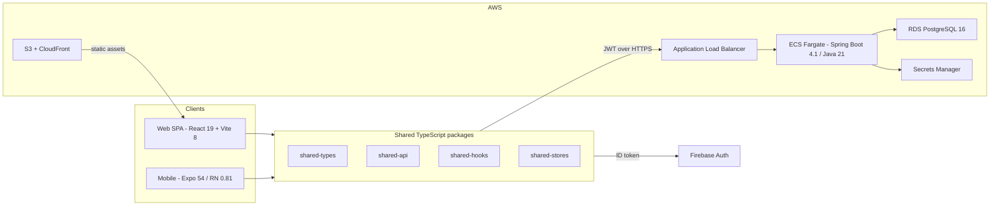

<div align="center">

# Flame

## National Football Administration Platform

**Built by [BackSpace Studios](https://backspacestudios.com)**

One governed platform for associations, leagues, clubs, players, referees and football businesses, from grassroots to elite competition.


</div>

---

> **About this repository.** Flame is proprietary software in production use. This repository is a public **engineering showcase**: architecture, domain model, decisions, metrics and short code samples written from scratch to illustrate the patterns. It contains **no production source code, credentials, customer data or infrastructure identifiers**. See [SECURITY.md](SECURITY.md).

## The problem

Football administration at national scale is usually fragmented:

- player records are scattered across leagues and clubs
- fixtures and lineups are coordinated by hand
- referee appointments are disconnected from the competition calendar
- compliance (contracts, documents, fees, suspensions) lives in spreadsheets

Flame replaces this with a **centralised registry** and **role-based workflows** that follow how a real association is governed:

```text
National Association
  +-- Provincial League
        +-- Division / Season
              +-- Club / Team -- Players, Lineups, Fixtures
```

## At a glance

| | |
|---|---|
| **Clients** | React 19 web SPA and an Expo / React Native mobile app sharing one TypeScript domain layer |
| **Backend** | Spring Boot 4.1 on Java 21: a modular monolith with **12 bounded contexts** |
| **Data** | PostgreSQL 16, schema-per-bounded-context, **53 JPA entities** |
| **API surface** | **~191 REST endpoints** protected by **164 method-level authorisation rules** |
| **Frontend scale** | **~44k lines** of TypeScript, **48 web pages**, **48 mobile screens**, **~149 shared data hooks** |
| **Roles** | 5 platform roles plus capability-based sub-roles (branch admin, mother-body admin, store owner) |
| **Automation** | 4 scheduled operational jobs, notification de-duplication, readiness engines |
| **Cloud** | AWS ECS Fargate, RDS, CloudFront, Secrets Manager, managed by Terraform, deployed by GitHub Actions over OIDC |

Full numbers: [docs/09-engineering-metrics.md](docs/09-engineering-metrics.md)

## Architecture



More detail: [system architecture](docs/02-architecture.md), [frontend](docs/05-frontend-architecture.md), [backend](docs/06-backend-architecture.md), [cloud and DevOps](docs/07-cloud-and-devops.md).

## What makes it non-trivial

- **Two readiness engines.** *Policy readiness* decides whether a season may start: squad sizes, approved documents, registered contracts, paid participation fees. *Operational readiness* decides whether a match week can go ahead: dates inside the week window, referees appointed, lineups submitted, reports filed and verified.
- **Hierarchical policy packs.** League rules are drafted, versioned and published. Divisions and seasons inherit or override them, and the resolved rule set drives enforcement in other contexts.
- **Discipline and finance engine.** Submitting a match report produces cards, which produce fines (billed to the team or the player) and suspensions. Suspensions count the current match and track yellow-card accumulation, and lineups reject suspended players. Every admin override needs a reason and is written to an audit log.
- **Fixture generation and scheduling.** The round-robin generator (single or double leg) and the auto-scheduler place fixtures on preferred match days inside each match-week window, with staggered kick-off times.
- **Lineup locking and privacy.** Lineups lock at a configurable deadline before kick-off. A team cannot see the opponent's lineup until both teams have submitted or kick-off has passed.
- **Referee operations.** Mother bodies own branches, branches serve leagues, and branch admins appoint officials to four fixture roles. Fee schedules record each match fee and card fee as it occurs, which gives separate totals for branch revenue and referee earnings.
- **One codebase shape for web and mobile.** Auth, theme, the API client and about 149 data hooks are platform-agnostic, with storage and navigation injected at startup.
- **Cost-aware cloud.** ECS runs in private subnets with no NAT gateway, reaching AWS services through VPC endpoints instead. A Terraform `hibernate` switch parks the whole stack at a few dollars a month and puts up a branded maintenance page.

## Who uses it

| Role | Highlights |
|---|---|
| **Super admin** | Federation-wide user management, leagues, referee bodies, marketplace governance |
| **League admin** | Divisions, seasons, fixtures, policy packs, contract and document approvals, finance |
| **Team manager** | Roster, compliance uploads, pitch-board lineup editor, match-week readiness |
| **Referee / branch admin** | Appointments, live match reports, branch fee schedules and revenue tracking |
| **Member** | Standings, player statistics, scouting rankings, marketplace |

## Screenshots

| Light | Dark |
|---|---|
|  |  |
|  |  |

More captures, the shot list and the rules for capturing role dashboards with fictional data: [media/](media/README.md).

## Documentation map

| Doc | What it covers |
|---|---|
| [01 Product overview](docs/01-product-overview.md) | Problem, stakeholders, product modules, governance hierarchy |
| [02 Architecture](docs/02-architecture.md) | System context, containers, request and auth flows |
| [03 Tech stack](docs/03-tech-stack.md) | Every layer, version and the reasoning behind it |
| [04 Domain model](docs/04-domain-model.md) | Bounded contexts, context map, role matrix |
| [05 Frontend architecture](docs/05-frontend-architecture.md) | Monorepo, shared packages, routing, state, theming |
| [06 Backend architecture](docs/06-backend-architecture.md) | Modular monolith, layering, schedulers, data strategy |
| [07 Cloud and DevOps](docs/07-cloud-and-devops.md) | AWS topology, CI/CD, Terraform, hibernation |
| [08 Security model](docs/08-security-model.md) | Firebase-to-JWT exchange, RBAC, secrets handling |
| [09 Engineering metrics](docs/09-engineering-metrics.md) | Size and complexity in numbers |
| [Domain deep dives](docs/domains/) | One document per bounded context |
| [Architecture decisions](docs/adr/) | ADRs with context, decision and consequences |
| [Diagrams](diagrams/) | Mermaid sources for every diagram |
| [Code samples](samples/) | Pattern illustrations written from scratch |

## Repository layout

```text
flame-showcase/
  docs/        architecture, domain deep dives, ADRs, metrics
  diagrams/    Mermaid sources (.mmd) and rendered SVGs
  samples/     clean-room code samples: frontend, backend, infra
  media/       screenshots and demo captures (fictional data)
  scripts/     redaction, link and diagram-index checks used by CI
```

## Contact

Interested in Flame for your association or league, or in working with BackSpace Studios? Visit [backspacestudios.com](https://backspacestudios.com).

---

<sub>Copyright (c) 2026 BackSpace Studios. All rights reserved. This repository is provided for viewing only. See [LICENSE](LICENSE).</sub>
