# Diagrams

Every diagram is a Mermaid source (`*.mmd`), so it can be reviewed in a pull request like code. GitHub renders the blocks below directly; pre-rendered SVGs live in [`svg/`](svg/).

CI re-renders every source with `@mermaid-js/mermaid-cli` on each push, so a broken diagram fails the build.

| # | Diagram | Shows | Discussed in |
|---|---|---|---|
| 01 | [System context](#01-system-context) | Who uses Flame and which external services it depends on. | [02-architecture.md](../docs/02-architecture.md) |
| 02 | [Containers](#02-containers) | Web and mobile clients, shared packages, the API and its data stores. | [02-architecture.md](../docs/02-architecture.md) |
| 03 | [Bounded-context map](#03-context-map) | The twelve backend modules and the direction of their dependencies. | [04-domain-model.md](../docs/04-domain-model.md) |
| 04 | [Identity token exchange](#04-auth-token-exchange) | Firebase proves identity; the API issues its own JWT and resolves roles per request. | [08-security-model.md](../docs/08-security-model.md) |
| 05 | [Request lifecycle](#05-request-lifecycle) | From a screen through TanStack Query, Axios, Spring Security and back. | [05-frontend-architecture.md](../docs/05-frontend-architecture.md) |
| 06 | [Season lifecycle](#06-season-lifecycle) | Draft to completed, with the readiness gate in front of activation. | [domains/02-competition.md](../docs/domains/02-competition.md) |
| 07 | [Policy resolution](#07-policy-resolution) | League pack, division and season bindings resolved into one effective rule set. | [domains/07-policy.md](../docs/domains/07-policy.md) |
| 08 | [Match-week readiness](#08-match-week-readiness) | Fixtures, referees and lineups converging before kickoff. | [domains/05-match.md](../docs/domains/05-match.md) |
| 09 | [Lineup lock decision](#09-lineup-lock) | One definition of "locked" shared by endpoints and the scheduler. | [domains/05-match.md](../docs/domains/05-match.md) |
| 10 | [Referee appointment and report](#10-referee-appointment-and-report) | Appointment, acceptance, the match report and its downstream effects. | [domains/06-referee.md](../docs/domains/06-referee.md) |
| 11 | [Discipline engine](#11-discipline-engine) | Cards in a report become suspensions and fines idempotently. | [domains/11-finance-discipline.md](../docs/domains/11-finance-discipline.md) |
| 12 | [Obligation lifecycle](#12-obligation-lifecycle) | Fees and fines from creation through payment, waiver or cancellation. | [domains/11-finance-discipline.md](../docs/domains/11-finance-discipline.md) |
| 13 | [AWS topology](#13-aws-topology) | Fargate in private subnets reaching AWS services through VPC endpoints, no NAT. | [07-cloud-and-devops.md](../docs/07-cloud-and-devops.md) |
| 14 | [CI/CD](#14-ci-cd) | GitHub Actions with OIDC for the API image and the static web build. | [07-cloud-and-devops.md](../docs/07-cloud-and-devops.md) |
| 15 | [Hibernate mode](#15-hibernate-mode) | One Terraform variable scales the platform to near-zero cost and back. | [07-cloud-and-devops.md](../docs/07-cloud-and-devops.md) |

## 01. System context

Who uses Flame and which external services it depends on.

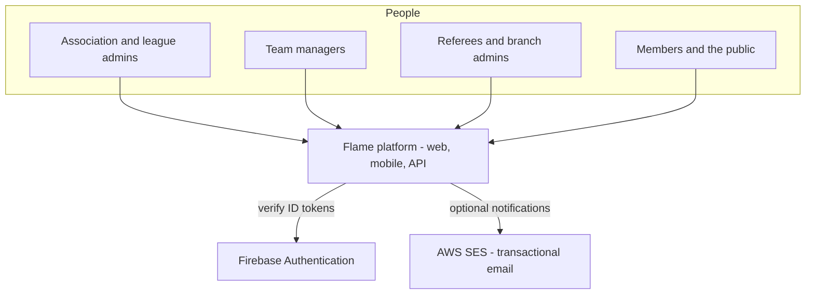

Source: [`01-system-context.mmd`](01-system-context.mmd) · SVG: [`svg/01-system-context.svg`](svg/01-system-context.svg)

## 02. Containers

Web and mobile clients, shared packages, the API and its data stores.

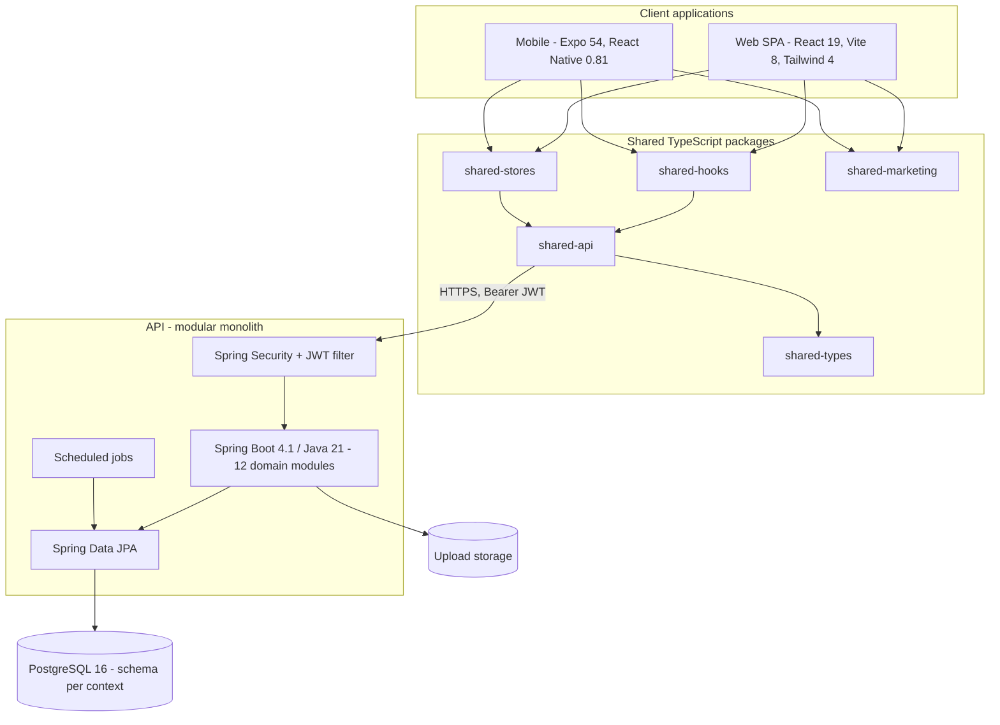

Source: [`02-containers.mmd`](02-containers.mmd) · SVG: [`svg/02-containers.svg`](svg/02-containers.svg)

## 03. Bounded-context map

The twelve backend modules and the direction of their dependencies.

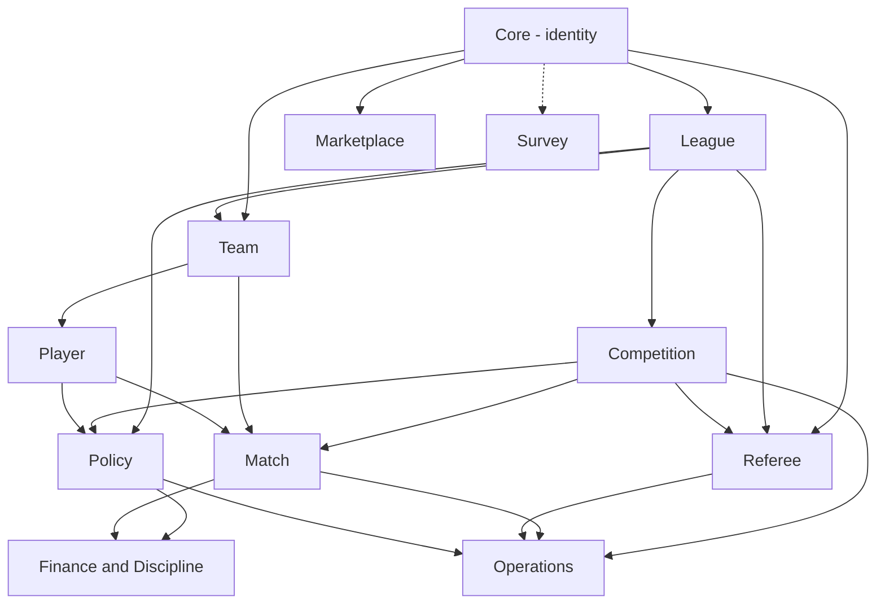

Source: [`03-context-map.mmd`](03-context-map.mmd) · SVG: [`svg/03-context-map.svg`](svg/03-context-map.svg)

## 04. Identity token exchange

Firebase proves identity; the API issues its own JWT and resolves roles per request.

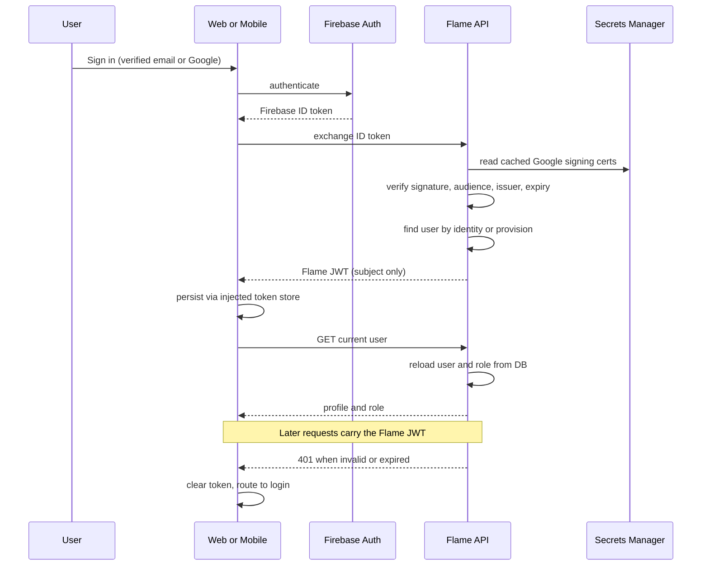

Source: [`04-auth-token-exchange.mmd`](04-auth-token-exchange.mmd) · SVG: [`svg/04-auth-token-exchange.svg`](svg/04-auth-token-exchange.svg)

## 05. Request lifecycle

From a screen through TanStack Query, Axios, Spring Security and back.

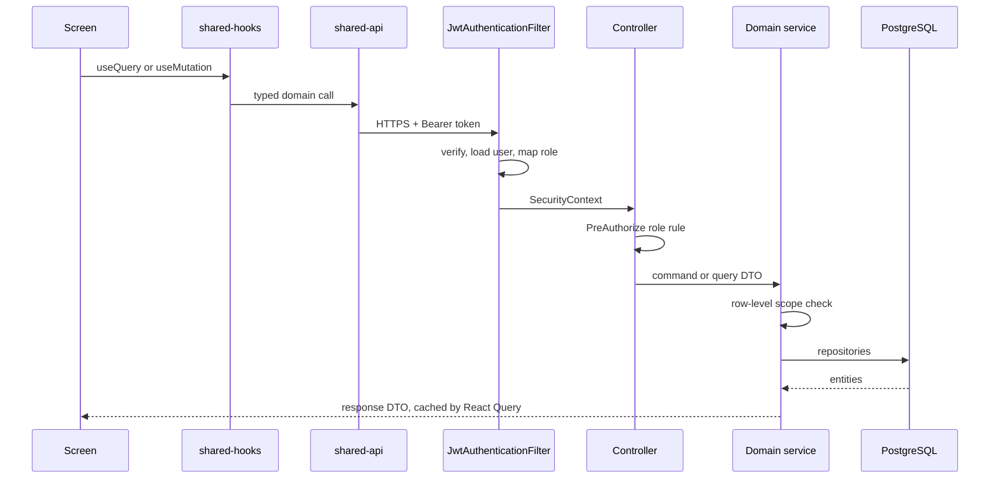

Source: [`05-request-lifecycle.mmd`](05-request-lifecycle.mmd) · SVG: [`svg/05-request-lifecycle.svg`](svg/05-request-lifecycle.svg)

## 06. Season lifecycle

Draft to completed, with the readiness gate in front of activation.

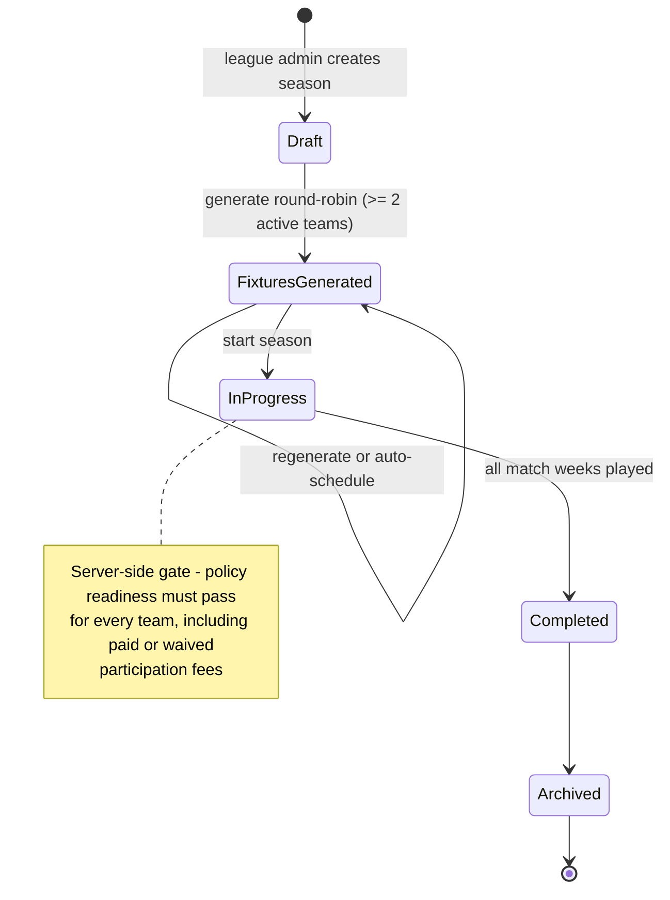

Source: [`06-season-lifecycle.mmd`](06-season-lifecycle.mmd) · SVG: [`svg/06-season-lifecycle.svg`](svg/06-season-lifecycle.svg)

## 07. Policy resolution

League pack, division and season bindings resolved into one effective rule set.

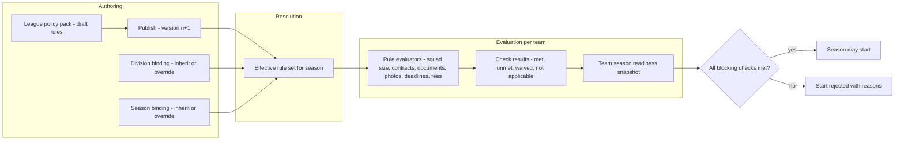

Source: [`07-policy-resolution.mmd`](07-policy-resolution.mmd) · SVG: [`svg/07-policy-resolution.svg`](svg/07-policy-resolution.svg)

## 08. Match-week readiness

Fixtures, referees and lineups converging before kickoff.

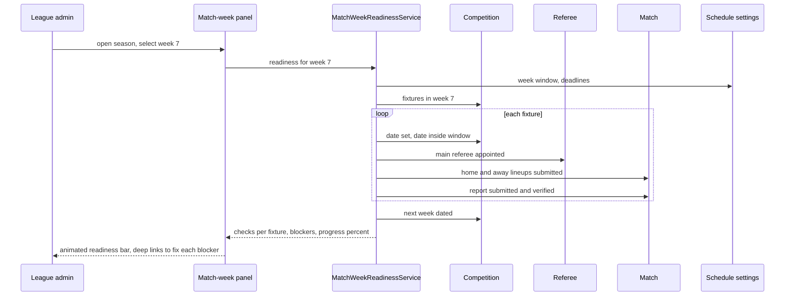

Source: [`08-match-week-readiness.mmd`](08-match-week-readiness.mmd) · SVG: [`svg/08-match-week-readiness.svg`](svg/08-match-week-readiness.svg)

## 09. Lineup lock decision

One definition of "locked" shared by endpoints and the scheduler.

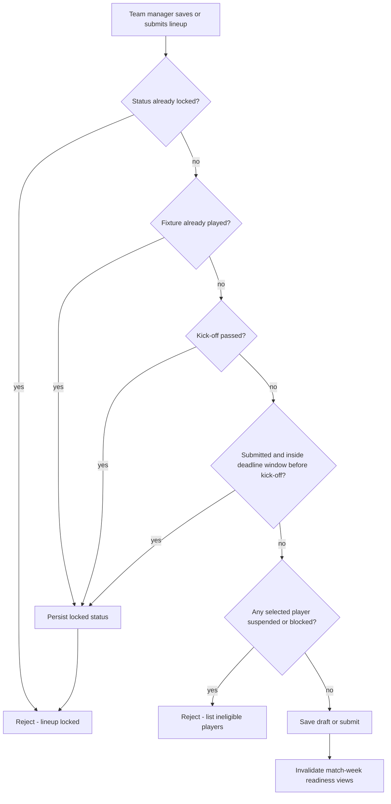

Source: [`09-lineup-lock.mmd`](09-lineup-lock.mmd) · SVG: [`svg/09-lineup-lock.svg`](svg/09-lineup-lock.svg)

## 10. Referee appointment and report

Appointment, acceptance, the match report and its downstream effects.

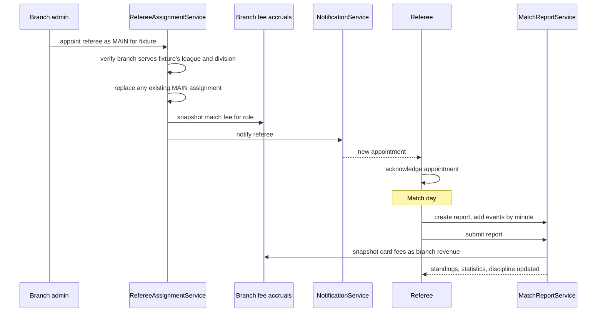

Source: [`10-referee-appointment-and-report.mmd`](10-referee-appointment-and-report.mmd) · SVG: [`svg/10-referee-appointment-and-report.svg`](svg/10-referee-appointment-and-report.svg)

## 11. Discipline engine

Cards in a report become suspensions and fines idempotently.

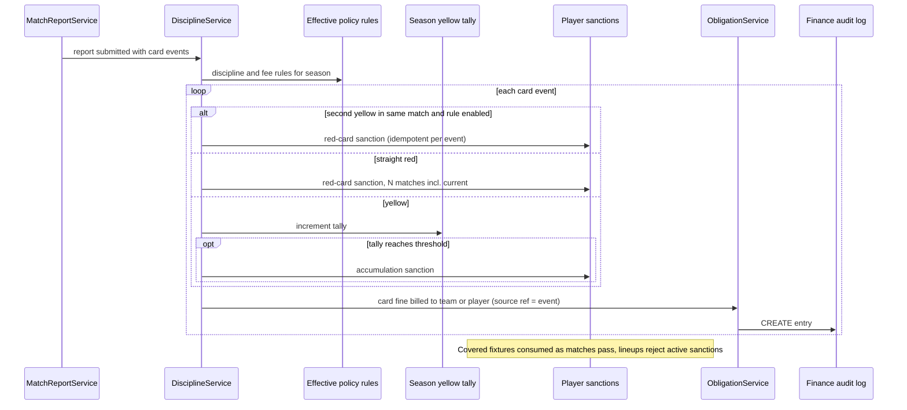

Source: [`11-discipline-engine.mmd`](11-discipline-engine.mmd) · SVG: [`svg/11-discipline-engine.svg`](svg/11-discipline-engine.svg)

## 12. Obligation lifecycle

Fees and fines from creation through payment, waiver or cancellation.

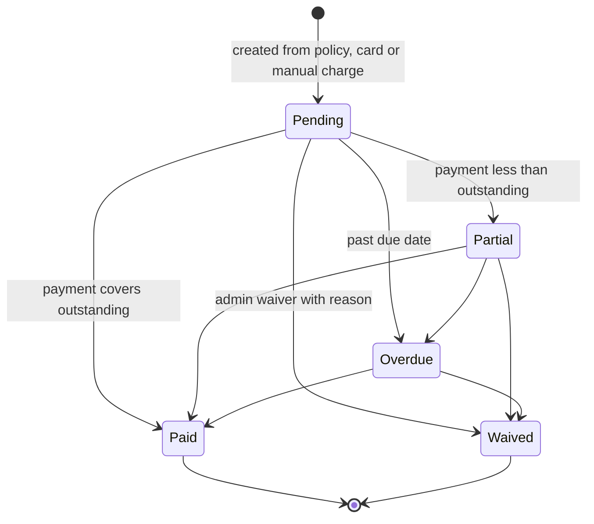

Source: [`12-obligation-lifecycle.mmd`](12-obligation-lifecycle.mmd) · SVG: [`svg/12-obligation-lifecycle.svg`](svg/12-obligation-lifecycle.svg)

## 13. AWS topology

Fargate in private subnets reaching AWS services through VPC endpoints, no NAT.

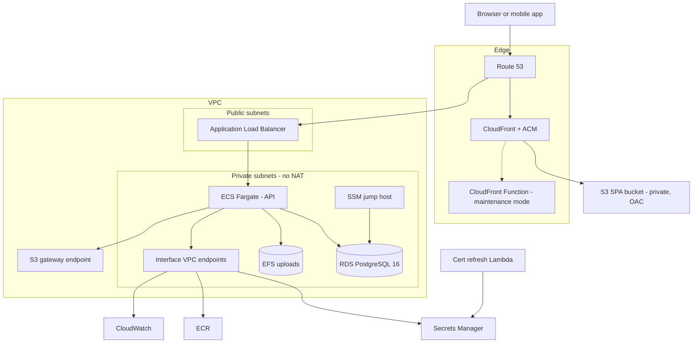

Source: [`13-aws-topology.mmd`](13-aws-topology.mmd) · SVG: [`svg/13-aws-topology.svg`](svg/13-aws-topology.svg)

## 14. CI/CD

GitHub Actions with OIDC for the API image and the static web build.

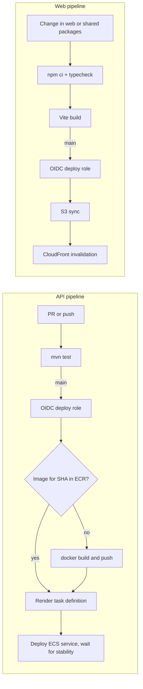

Source: [`14-ci-cd.mmd`](14-ci-cd.mmd) · SVG: [`svg/14-ci-cd.svg`](svg/14-ci-cd.svg)

## 15. Hibernate mode

One Terraform variable scales the platform to near-zero cost and back.

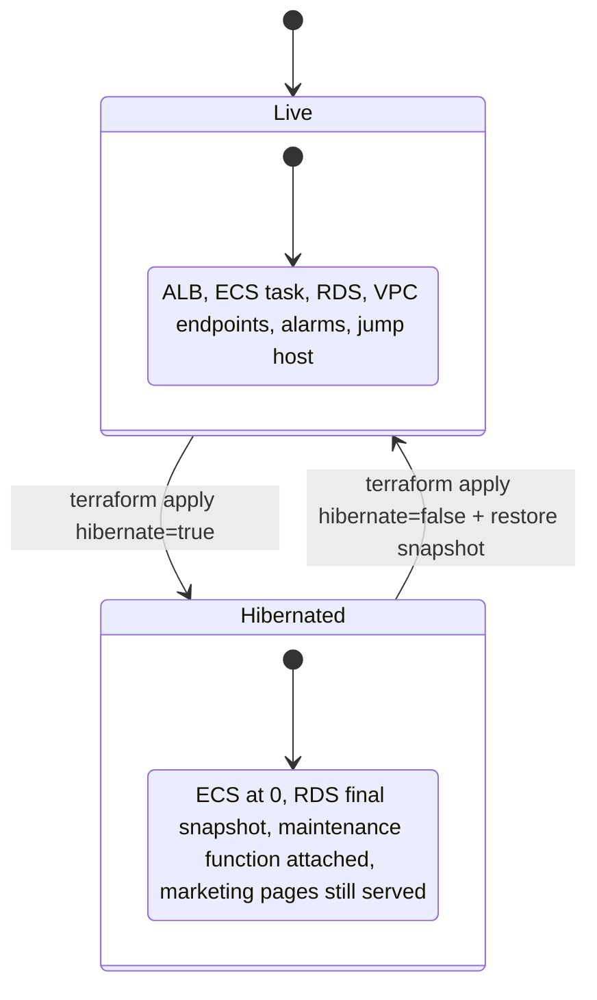

Source: [`15-hibernate-mode.mmd`](15-hibernate-mode.mmd) · SVG: [`svg/15-hibernate-mode.svg`](svg/15-hibernate-mode.svg)
