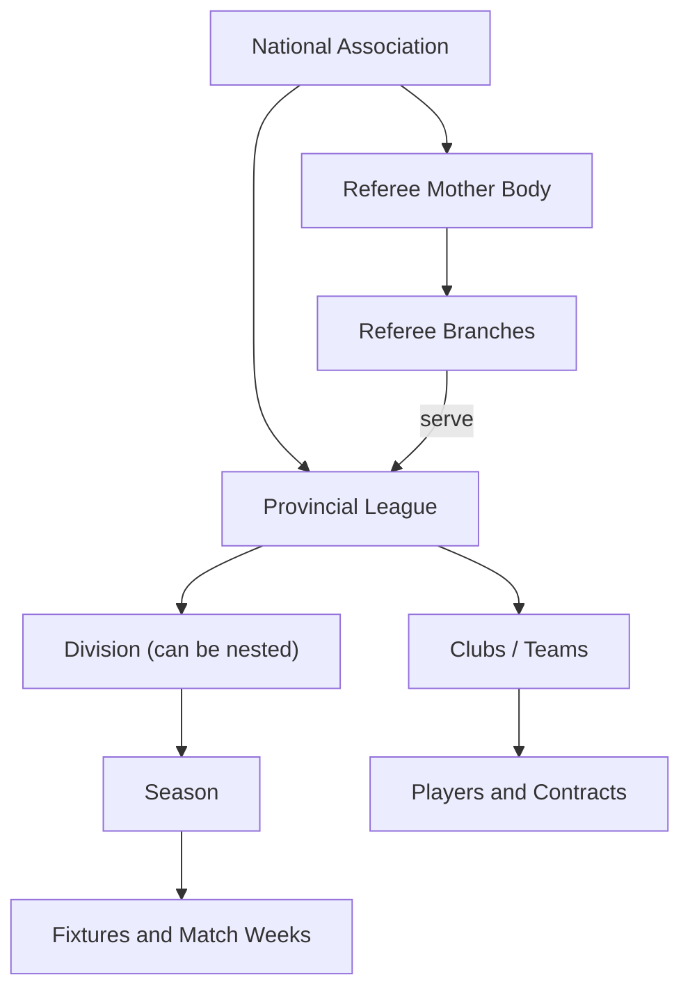

# 01 — Product Overview

## What Flame is

Flame is a **national football administration platform**. It gives a football association one governed system for registrations, competitions, officiating, compliance and commerce, replacing the patchwork of spreadsheets, messaging groups and paper forms that most federations still depend on.

> Enterprise football infrastructure for associations, leagues, clubs, players, referees and football businesses, from grassroots to elite competition.

## The problem

| Pain point | What it looks like without Flame |
|---|---|
| Fragmented player records | The same player exists in three club spreadsheets with three different dates of birth |
| Manual fixtures | Season calendars built by hand, re-built every time a team withdraws |
| Disconnected officiating | Referee appointments tracked in chat threads, unrelated to the fixture list |
| Invisible compliance | Contracts, medical documents and fees are checked days before kick-off, if at all |
| No single source of truth | Standings, statistics and disciplinary records disagree between bodies |

## Stakeholders

| Stakeholder | Role in the ecosystem | What Flame gives them |
|---|---|---|
| **National association** | Governance, federation-wide oversight | User and league management, referee bodies, marketplace governance |
| **Provincial leagues** | Regional competition structures | Division hierarchies, season lifecycle, policy packs |
| **League administrators** | Run seasons day to day | Fixtures, scheduling, approvals, readiness dashboards, finance |
| **Team managers** | Run a club's squad | Roster, compliance uploads, lineups, match-week readiness |
| **Players** | The registry's core asset | A single digital profile, contracts, statistics, scouting visibility |
| **Referees and referee bodies** | Officiating | Applications, appointments, match reports, branch finance |
| **Football businesses** | Commerce | Verified storefronts and product catalogues |

## Product modules

| Module | Bounded context | Summary |
|---|---|---|
| League Management | `league` | Multi-level division hierarchies with delegated authority |
| Competition Operations | `competition` | Seasons, round-robin fixtures, scheduling, lifecycle |
| Team Administration | `team` | Club registration, manager approvals, rosters |
| Player Registry | `player` | Central player records and contracts |
| Match Operations | `match` | Lineups, match reports, events, standings, statistics, scouting |
| Referee Operations | `referee` | Mother bodies, branches, registrations, appointments |
| Policy and Compliance | `policy` | Versioned rule packs and season readiness |
| Match-week Operations | `operations` | Operational readiness, scheduled jobs, notifications |
| Finance and Discipline | `finance` | Fees, payments, waivers, sanctions, referee fee accruals |
| Football Marketplace | `marketplace` | Store applications, products, bulk pricing |
| Surveys | `survey` | Public questionnaires |

All of these sit on the **core** identity context (users, roles, authentication).

## Governance hierarchy

The platform's design follows four governance principles:

- **Role-based access control.** Each stakeholder sees and changes only what their role and assignment allow.
- **Delegated administration.** The association delegates to leagues, leagues to divisions, and referee mother bodies to branches.
- **Centralised registry.** Players, officials, clubs and competition records each have one source of truth.
- **Audit and integrity.** Approval workflows, mandatory override reasons and an append-only finance audit log.

## A season, end to end

1. A league admin creates a **season** in a division and publishes the league's **policy pack**: minimum squad size, required documents, participation fee, discipline rules.
2. Team managers register players, upload compliance documents and pay participation fees. The **season readiness** dashboard shows progress for each team.
3. The league admin **generates fixtures** (single or double round-robin) and **auto-schedules** them onto the preferred match day inside each match-week window.
4. The season can move to *In progress* only when policy readiness passes, and the server enforces this.
5. Each match week, the **operations** context checks that fixtures are dated, referees appointed, and lineups submitted. Scheduled jobs send reminders when any of these are missing.
6. The referee files a **match report**. Submitting it updates standings, player statistics and performance tokens, raises card fines and applies suspensions.
7. Suspended players are blocked from future lineups automatically, until they have served their ban.

## Platforms

| Platform | Audience |
|---|---|
| **Web app** | Every role; the primary admin surface |
| **Mobile app** (iOS / Android) | Match-day users: team managers, referees, members |
| **Marketing site** | Public landing, privacy and terms pages |

Next: [02 — Architecture](02-architecture.md)
