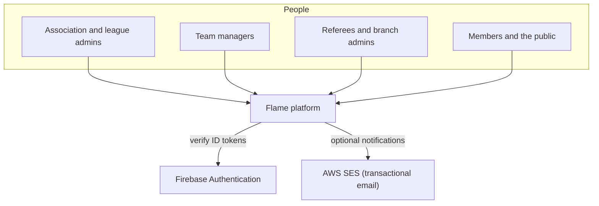
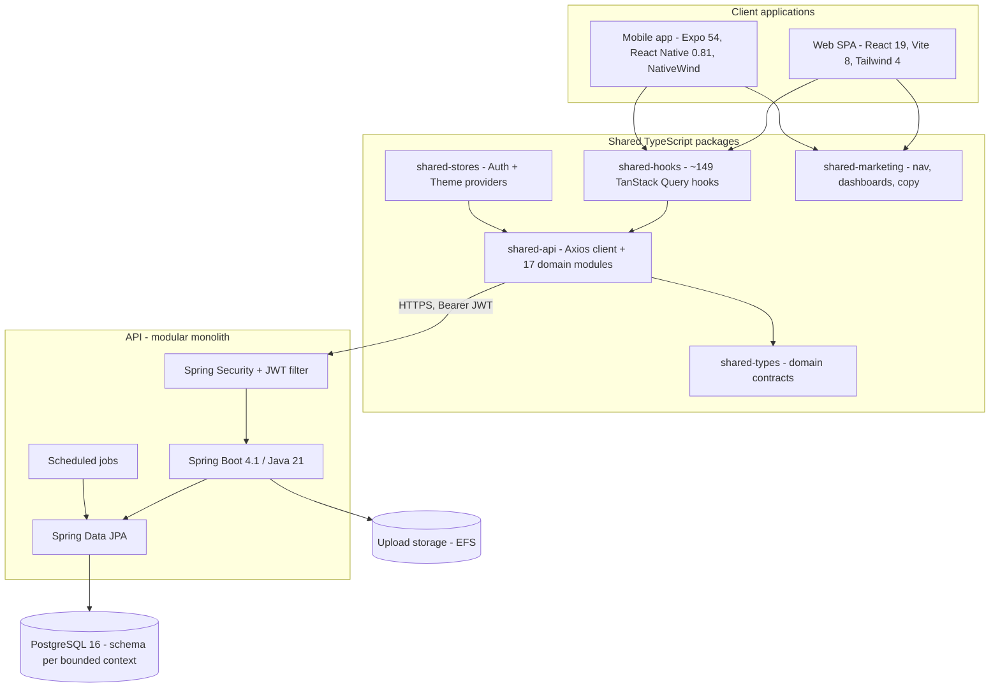
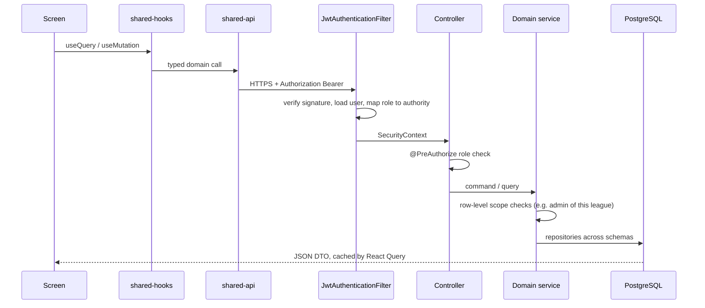
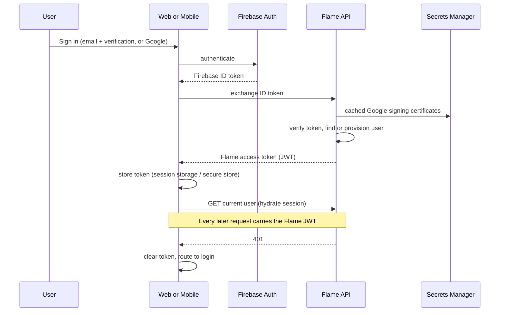
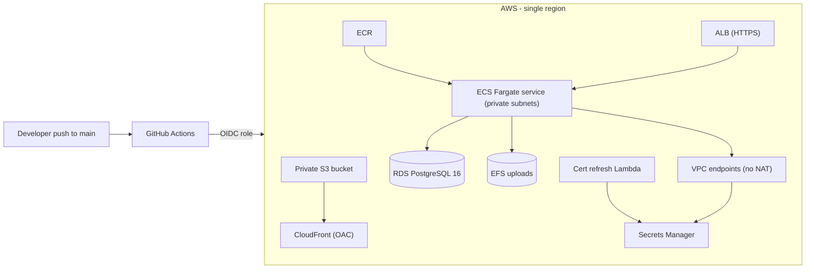

# 02 — System Architecture

Flame is a **three-tier system**. Two client applications (web and mobile) share their business logic through internal TypeScript packages. Both talk to a single Spring Boot API over HTTPS with bearer tokens, and the API owns a PostgreSQL database. Firebase Authentication handles identity proofing; Flame's own API owns authorisation.

## System context

## Containers

## Request lifecycle

1. A screen calls a React Query hook. The **same hook** runs on web and mobile.
2. The hook calls a typed function in the shared API package.
3. The Axios client attaches the bearer token kept in memory.
4. `JwtAuthenticationFilter` verifies the token and loads the user **from the database on every request**, so role changes take effect immediately.
5. `@PreAuthorize` enforces role access on the controller method. The service then applies **row-level** scope (for example, "is this user an admin of *this* league?").
6. The response is a DTO, never an entity. React Query caches it and invalidates related keys after mutations.

## Authentication: Firebase identity, Flame authorisation

Why this split: Firebase handles password storage, email verification and federated sign-in, which are expensive and risky to build in-house. Flame keeps **authorisation**, roles and data access completely inside its own API. See [ADR-0003](adr/0003-firebase-identity-backend-jwt.md) and [08 — Security model](08-security-model.md).

## Cross-domain cache invalidation

Readiness is derived from many other contexts, so the frontend invalidates related data when one of them changes:

| Mutation | Invalidated views |
|---|---|
| Player, contract or document change | Season readiness, team readiness |
| Lineup submit, fixture reschedule, referee appointment | Match-week readiness, fixture readiness, week list |
| Match report submit | All of the above, plus standings, player stats, scouting rankings |
| Season status change | Season and readiness views |

## Deployment view

Detail in [07 — Cloud and DevOps](07-cloud-and-devops.md).

Prev: [01 — Product overview](01-product-overview.md) · Next: [03 — Tech stack](03-tech-stack.md)
