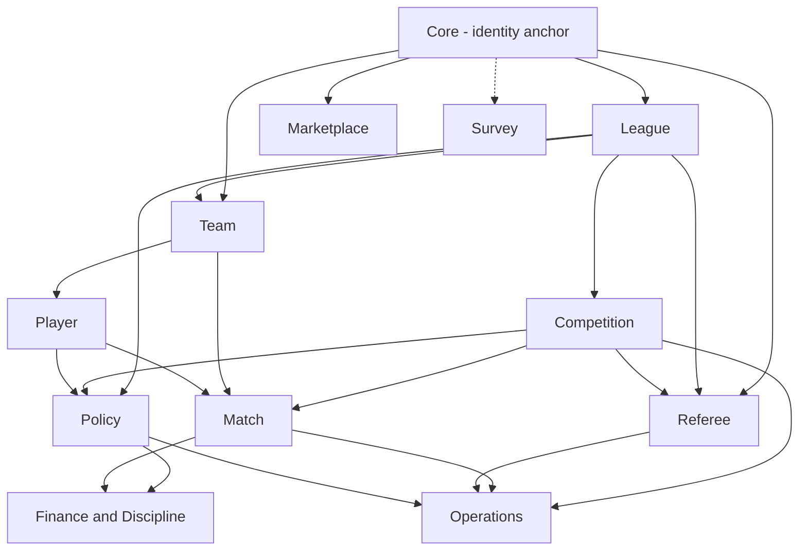
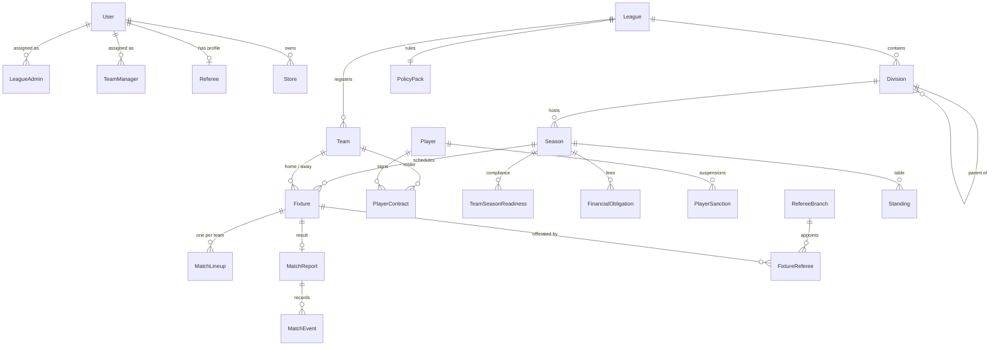

# 04 — Domain Model

Flame applies **pragmatic domain-driven design**: clearly bounded contexts with a consistent internal layering, plus explicit orchestration services where workflows cross boundaries. It does not use aggregates and domain events everywhere.

## Bounded contexts

| # | Context | Responsibility | Entities | Deep dive |
|---|---|---|---|---|
| 0 | **Core** | Identity, authentication, users, roles | 2 | [00-core](domains/00-core.md) |
| 1 | **League** | Leagues, nested divisions, league admins | 3 | [01-league](domains/01-league.md) |
| 2 | **Competition** | Seasons, fixtures, generation, scheduling settings | 4 | [02-competition](domains/02-competition.md) |
| 3 | **Team** | Clubs, team managers, approvals | 2 | [03-team](domains/03-team.md) |
| 4 | **Player** | Player registry, contracts | 2 | [04-player](domains/04-player.md) |
| 5 | **Match** | Lineups, reports, events, standings, statistics, tokens | 8 | [05-match](domains/05-match.md) |
| 6 | **Referee** | Mother bodies, branches, registrations, appointments | 8 | [06-referee](domains/06-referee.md) |
| 7 | **Policy** | Rule packs, bindings, documents, season readiness | 4 | [07-policy](domains/07-policy.md) |
| 8 | **Operations** | Match-week readiness, schedulers, notifications | 2 | [08-operations](domains/08-operations.md) |
| 9 | **Marketplace** | Stores, applications, products, bulk pricing | 5 | [09-marketplace](domains/09-marketplace.md) |
| 10 | **Survey** | Public questionnaires | 5 | [10-survey](domains/10-survey.md) |
| 11 | **Finance and Discipline** | Obligations, payments, sanctions, referee fee accruals | 8 | [11-finance-discipline](domains/11-finance-discipline.md) |

The total is **53 entities**. A shared `config` module holds cross-cutting web configuration.

## Context map

| Context | Relationship | Depends on |
|---|---|---|
| Core | Upstream to everything | — |
| League | Upstream | Core |
| Team, Player | Downstream of League | Core, League |
| Competition | Downstream of League | League, Team |
| Match | Downstream of Competition | Competition, Team, Player |
| Referee | Parallel to Match | Core, League, Competition |
| Policy | Cross-cutting rules | League, Competition, Team, Player |
| Finance | Applies Policy rules to Match outcomes | Policy, Match, Competition |
| Operations | Orchestrator | Competition, Match, Referee, Policy |
| Marketplace, Survey | Largely autonomous | Core |

## Core relationships

## Ubiquitous language (selected)

| Term | Meaning |
|---|---|
| **League** | A governed competition body (amateur, professional or youth) |
| **Division** | A tier within a league; can be nested |
| **Season** | One competition cycle within a division |
| **Fixture** | A scheduled match between two teams, belonging to a match week |
| **Match week** | A round of fixtures; the unit of operational readiness |
| **Policy pack** | A league's versioned rule set (draft, then published) |
| **Binding** | A division- or season-level override of league rules |
| **Readiness** | Whether a season may start (policy) or a match week may proceed (operations) |
| **Obligation** | Money owed by a team or player, with a lifecycle |
| **Sanction** | A suspension covering an ordered set of upcoming fixtures |
| **Branch** | A referee organisation that serves one or more leagues |

## Role matrix

Platform roles are stored on the user. Sub-roles are **capabilities derived from assignment records**, which avoids an explosion of role values. See [ADR-0003](adr/0003-firebase-identity-backend-jwt.md) and [08 — Security model](08-security-model.md).

| Capability | Super admin | League admin | Team manager | Referee | Member |
|---|:-:|:-:|:-:|:-:|:-:|
| Manage users and leagues | Yes | | | | |
| Manage divisions and seasons (own league) | Yes | Yes | | | |
| Author and publish policy packs | Yes | Yes | | | |
| Approve contracts and documents | Yes | Yes | | | |
| Generate and schedule fixtures | Yes | Yes | | | |
| Record payments, waive fees, adjust sanctions | Yes | Yes (full finance access) | | | |
| Manage roster and upload documents | | | Yes | | |
| Submit lineups | | | Yes | | |
| View own team's obligations and suspensions | | | Yes | | |
| File and submit match reports | | | | Yes | |
| Appoint referees to fixtures | | | | Branch admin | |
| Branch fee schedules and revenue | | | | Branch admin | |
| View child branches (read-only) | | | | Mother-body admin | |
| Manage referee bodies and registrations | Yes | | | Branch admin (own branch) | |
| Standings, statistics, scouting | Yes | Yes | Yes | Yes | Yes |
| Marketplace browse / own a store | Yes | Yes | Yes | Yes | Yes (store owner) |

## Persistence strategy

- **One PostgreSQL schema per bounded context** (core, league, team, player, competition, referee, policy, operations, finance, marketplace, survey). The match package shares the competition schema for fixture-adjacent tables.
- **UUID primary keys** throughout. This allows safe client-side references and makes environments easy to merge.
- **JSONB** where the shape is rule-driven or document-like: policy rules, lineups, readiness summaries, fixture-generation configuration.
- **Computed vs stored.** Operational readiness is computed on read. Policy readiness is cached per team and season, and recalculated on demand.
- **Idempotency keys** on generated records (card fines and sanctions reference the source event or fixture), so reprocessing a report never double-charges.

Prev: [03 — Tech stack](03-tech-stack.md) · Next: [05 — Frontend architecture](05-frontend-architecture.md)
