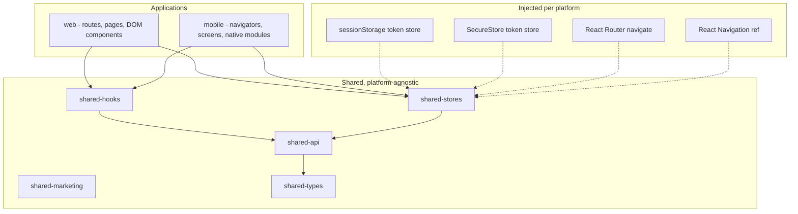

# 05 — Frontend Architecture

The frontend is an **npm-workspaces monorepo**: two applications and six internal packages. The design goal is that **everything except UI and platform integration is written once** and shared by the web and mobile apps.

## Workspace layout

```text
frontend/
  apps/
    web/        React 19 + Vite 8 SPA (all roles, marketing site, legal pages)
    mobile/     Expo 54 + React Native 0.81 app
  packages/
    shared-types/       domain contracts (~165 types)
    shared-api/         Axios client factory + 17 domain API modules
    shared-hooks/       ~149 TanStack Query hooks
    shared-stores/      AuthProvider, ThemeProvider (platform-agnostic)
    shared-marketing/   role navigation, role dashboards, landing copy
    tailwind-config/    design tokens
```



## Pattern 1: dependency injection for platform differences

Shared providers never import `window`, `localStorage`, `expo-secure-store` or a router. Each app instead **configures** them once at startup:

```ts
// web entry (illustrative)
configureAuth({ tokenStore: webTokenStore, onNavigate: (to) => router.navigate(routeFor(to)) });
configureTheme({ storage: webThemeStorage });
createApiClient({ baseURL: env.API_URL, tokenStore: webTokenStore, onUnauthorized: goToLogin });
```

Because the same `AuthProvider` runs unchanged on React DOM and React Native, login, signup, session restore and logout behave identically on both platforms. A clean-room version is in [`samples/frontend/src/auth`](../samples/frontend/src/auth/).

## Pattern 2: a typed data layer in three tiers

| Tier | Package | Responsibility |
|---|---|---|
| Contract | `shared-types` | Request and response types that mirror the API's DTOs |
| Transport | `shared-api` | One module per domain; every function returns typed data, never raw Axios responses |
| State | `shared-hooks` | Query keys, caching policy, mutations and **cross-domain invalidation** |

Screens consume hooks only; they never call Axios. Defaults: 5-minute stale time, a single retry, and 60-second polling for the notification inbox.

## Pattern 3: role-driven navigation as configuration

Navigation items and dashboard widgets for each role are **data** in `shared-marketing`, not code in each app:

- the web sidebar and the mobile tab bar both read the same role-to-navigation map
- capability-based entries (Branch Admin, Mother Body, My Store) are injected when the corresponding assignment exists
- adding a role-specific feature means adding one configuration entry, and both platforms pick it up

## Routing and guards

| | Web | Mobile |
|---|---|---|
| Router | React Router 7 data router | React Navigation 7 |
| Public | Landing, login, signup, privacy, terms | Auth stack: landing, login, signup |
| Authenticated | About 44 routes under `/app` inside a shell layout | 6 bottom tabs + 37 stack screens |
| Role enforcement | `ProtectedRoute` with `allowedRoles` (loading, then redirect or 403) | `withRoleGuard` higher-order component on 18 screens |

Guards are a **user-experience layer** only. The API is the authoritative gate ([08 — Security model](08-security-model.md)).

## Forms

Forms use React Hook Form with Zod resolvers: 18 forms validated by 14 schemas. TypeScript types are **inferred from the schemas**, so validation and typing cannot drift apart. Some of the most involved forms:

- **Team registration**: multi-step, with logo upload and division assignment
- **Lineup editor**: a pitch board with formation templates, a starting XI, substitutes, staff, player blocker chips and a lock countdown
- **Policy wizard**: presets, rule cards, parameter validation for each rule key, and draft or publish
- **Match report**: events by minute (goals, cards, substitutions), conditions, and lineups confirmed against the submitted squads

## Theming

- light and dark themes from one token set
- web: CSS custom properties (`--shell-*`) switched by `ThemeProvider`, consumed by Tailwind 4
- mobile: the same token names through NativeWind
- theme preference persists through the injected storage adapter

## Platform-status awareness

The web app reads a small status document served next to the SPA. When the platform is **hibernated** (see [07 — Cloud and DevOps](07-cloud-and-devops.md)), client-side navigation to non-public routes turns into a full page load. CloudFront then serves a branded maintenance page, while the marketing pages stay online.

## Build and delivery

- Vite production build, with Firebase web config injected from CI secrets at build time
- static assets synced to S3 and served through CloudFront, followed by a cache invalidation
- a Docker image (Node build stage, then an nginx runtime stage) for production-like local runs

Prev: [04 — Domain model](04-domain-model.md) · Next: [06 — Backend architecture](06-backend-architecture.md)
