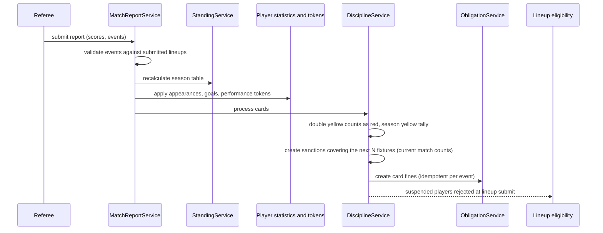

# 06 — Backend Architecture

The API is a **modular monolith**: one Spring Boot 4.1 / Java 21 deployable, internally split into bounded-context modules that share a consistent layering and a schema-per-context PostgreSQL database.

## Modules

```text
api/
  core/          identity, users, auth, security filter, uploads
  league/        leagues, divisions, league admins
  team/          teams, team managers
  player/        players, contracts
  competition/   seasons, fixtures, round-robin generator, schedule settings
  match/         lineups, reports, events, standings, statistics, performance tokens
  referee/       mother bodies, branches, registrations, appointments, dashboards
  policy/        policy packs, bindings, rule validation, readiness, documents
  operations/    match-week readiness, lineup lock, notifications, scheduler
  finance/       obligations, payments, audit log, sanctions, referee fee accruals
  marketplace/   stores, applications, products, bulk pricing
  survey/        public surveys
  config/        cross-cutting web configuration
```

| Module | Approx. LOC | Entities | Notes |
|---|---:|---:|---|
| referee | 2,550 | 8 | Largest module: two admin tiers and three dashboards |
| finance | 2,250 | 8 | Obligation state machine, discipline engine, branch accruals |
| match | 2,200 | 8 | Report submission fans out to standings, statistics, tokens, finance |
| operations | 1,600 | 2 | Readiness, lock rules, 4 cron jobs, notification de-duplication |
| policy | 1,600 | 4 | JSONB rules, hierarchical resolution, parameter validator |
| core | 1,500 | 2 | Firebase token exchange, JWT, user provisioning |
| league | 1,350 | 3 | Nested divisions, capacity validation |
| competition | 1,100 | 4 | Generator, auto-scheduler, lifecycle gates |
| marketplace | 1,050 | 5 | |
| team | 1,000 | 2 | Capacity rules, manager approvals |
| player | 900 | 2 | |
| survey | 300 | 5 | |

## Layering inside every module

```text
controller/   REST endpoints, @PreAuthorize, request validation
service/      business rules, row-level scoping, cross-context orchestration
repository/   Spring Data JPA interfaces
entity/       JPA entities mapped to the module's schema
dto/          request and response records (entities never leave the service layer)
enums/        domain vocabularies (statuses, rule keys, check keys, fee types)
```

Totals: **39 controllers, 49 services, 53 repositories, 122 DTOs, 50 enums, about 191 endpoints**.

## Cross-context orchestration

Some workflows deliberately cross module boundaries. Each one is owned by a single orchestrating service, so there is one place that defines the workflow:



Other orchestrators:

- **Policy readiness**: resolves the effective rules (league pack plus division and season bindings), then evaluates every rule key for every team in the season. It caches a summary for each team and gates the season's move to *In progress*.
- **Match-week readiness**: computes check results for each fixture (dates set and inside the week window, main referee appointed, both lineups submitted, report submitted and verified). Progress is the share of blocking checks that pass.
- **Lineup lock**: blocks edits once the lineup is locked, the fixture has been played, kick-off has passed, or the deadline before kick-off has been reached after submission. It persists the lock the first time it fires.

## Scheduled jobs

| Job | Schedule | Purpose |
|---|---|---|
| Upcoming fixtures scan | every 15 minutes | Lineup reminders 24 hours before kick-off and at the deadline |
| Referee gap scan | daily 08:00 | Alert branch admins when a fixture inside its appointment window has no main referee |
| Next-week dates scan | daily 09:00 | Alert league admins when the next match week is still undated |
| Overdue report scan | every 30 minutes | Remind referees when a report is overdue after kick-off |

All jobs cover only in-progress seasons. Delivery is **de-duplicated** through a delivery log keyed by notification type, fixture and recipient, so a job that runs every 15 minutes never sends the same reminder twice.

## Fixture generation and scheduling

- **Round-robin** using the circle method. Single-leg seasons have *n−1* match weeks; double-leg seasons mirror the first half with home and away swapped. An odd team count adds a bye.
- **Auto-scheduling** puts each match week on the season's preferred match day inside its date window, and staggers kick-off times when several fixtures share a day.
- **Manual rescheduling** is validated against the match-week window.

A clean-room implementation of the generator, with tests, is in [`samples/backend`](../samples/backend/).

## Data strategy

- PostgreSQL 16 with **one schema per bounded context**; UUID keys throughout
- Hibernate `ddl-auto=none` in production; the schema is managed by versioned SQL scripts
- JSONB for policy rules, lineups, readiness summaries and generation configuration
- money stored as `numeric` with an ISO currency for each league; obligations keep both amount and outstanding amount
- file uploads on a mounted volume (EFS in production), served through a controlled resource handler

## Configuration and secrets

- every environment-specific value comes from environment variables; production injects them from **AWS Secrets Manager** through the ECS task definition
- the service fails to start if a required secret is missing; there are no built-in fallback credentials
- Firebase token-signing certificates come from Secrets Manager, refreshed by a scheduled Lambda, so the private-subnet service needs **no internet egress**

## Testing

- JUnit 5 with Spring Boot Test, using H2 in PostgreSQL compatibility mode so CI needs no database server
- focused unit tests on the highest-risk logic: round-robin match-week estimates, division capacity validation, team capacity rules
- the CI pipeline runs `mvn test` before every deployment

## Container

- multi-stage build: a Maven build stage, then a slim JRE 21 runtime
- runs as a **non-root** user, with JVM memory set as a percentage of the container limit
- a health check against the Actuator health endpoint, also used by the load balancer's target group

Prev: [05 — Frontend architecture](05-frontend-architecture.md) · Next: [07 — Cloud and DevOps](07-cloud-and-devops.md)
