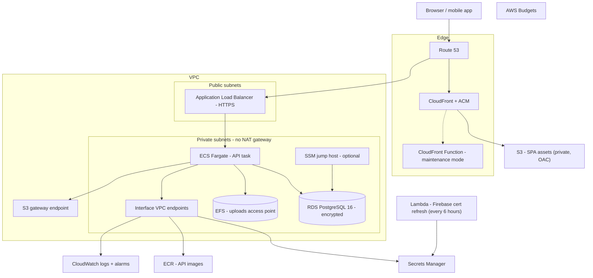
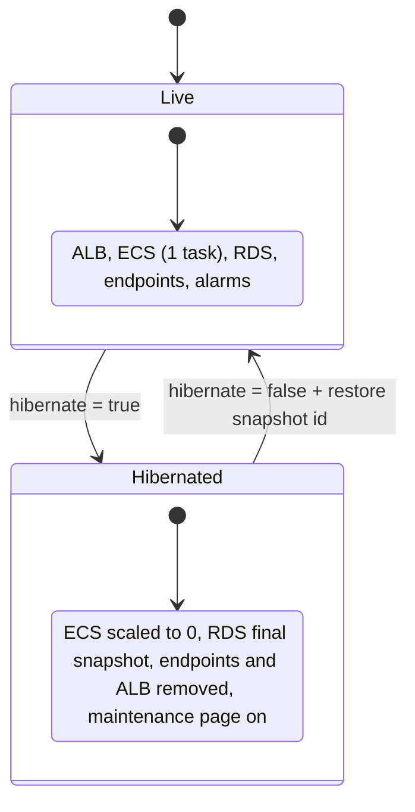
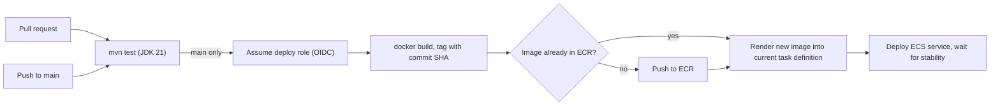
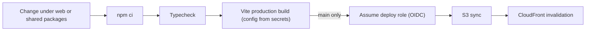

# 07 — Cloud and DevOps

Flame runs on AWS in a single region. Everything is described in **Terraform** and deployed by **GitHub Actions** over **OIDC**, so there are no long-lived cloud credentials in CI.

> All identifiers on this page are placeholders. Real account numbers, ARNs, resource IDs and hostnames are never published.

## Production topology



### Design choices

| Choice | Rationale |
|---|---|
| **No NAT gateway** | The API needs only AWS services; interface endpoints plus an S3 gateway endpoint give private access without a NAT's hourly and per-GB cost or its open egress path |
| **Firebase certificates through Lambda** | The private service can't reach Google directly, so a scheduled Lambda copies the token-signing certificates into Secrets Manager |
| **Private S3 + Origin Access Control** | The bucket is never public; only CloudFront can read it |
| **EFS for uploads** | Survives task replacement; mounted through an access point with a fixed POSIX owner |
| **SSM jump host instead of SSH** | Database maintenance (dumps, migrations) needs no open inbound ports |
| **Deletion protection + final snapshots** | The database cannot be destroyed by accident, even through Terraform |

## Terraform layout

```text
terraform/
  versions.tf          provider pins, optional remote state backend
  variables.tf         region, hibernate toggle, snapshot ids, feature flags
  network.tf           VPC, subnets, route tables, VPC endpoints
  security_groups.tf   least-privilege SG chain: ALB -> ECS -> RDS / EFS / endpoints
  alb.tf               load balancer, HTTPS listener, target group, health check
  ecs.tf               cluster, task definition (secrets from Secrets Manager), service
  ecr.tf               image repository with lifecycle policy
  rds.tf               PostgreSQL instance, subnet group, parameter group
  efs.tf               file system, access point, mount targets
  secrets.tf           secret containers (values set out-of-band)
  lambda_certs.tf      cert refresh function + schedule
  web.tf               S3 bucket, CloudFront distribution, OAC, maintenance function
  dns.tf               hosted zone records, ACM validation
  iam.tf               task roles, GitHub OIDC provider + deploy roles
  alarms.tf            CloudWatch alarms -> SNS
  budgets.tf           cost budgets and alerts
  jump_host.tf         SSM-managed maintenance instance
```

The stack was first built by hand. It was then **adopted into Terraform** with `import` blocks until the plan showed zero changes, which turned an undocumented environment into reproducible code without downtime.

A sanitised outline showing the hibernate pattern is in [`samples/infra/terraform`](../samples/infra/terraform/).

## Hibernate mode

A single variable parks the whole platform at **a few dollars a month** without losing data.



| Hibernated | Kept |
|---|---|
| Interface endpoints, ALB, API DNS record, RDS instance (after final snapshot), jump host, alarms | VPC, security groups, ECS cluster and service definition, ECR, EFS, S3, CloudFront, DNS zone, certificates, secrets, Lambda, budgets |

While hibernated, a **CloudFront Function** keeps the marketing pages and static assets online and returns a branded 503 page for application routes. It also tells the SPA that the platform is paused. Resuming restores RDS from the snapshot under the **same identifier**, so connection strings are unchanged.

## CI/CD

### API pipeline



- **Immutable tags**: images are tagged with the commit SHA, so re-running a workflow reuses the existing image
- **Task definition is fetched and re-rendered**, not hard-coded, so environment wiring stays in Terraform
- **Waits for service stability**: a failed rollout fails the pipeline

### Web pipeline



- path filters, so web deploys run only when web code, shared packages or the lockfile change
- public Firebase web configuration is injected at build time from repository secrets

An OIDC workflow template with placeholder ARNs is in [`samples/infra/github-actions`](../samples/infra/github-actions/).

## Operations

- **Health**: Actuator liveness and readiness probes, used by the container health check and the ALB target group
- **Alarms**: CloudWatch alarms on service, load balancer and database health, delivered through SNS
- **Cost**: AWS Budgets on actual and forecast spend
- **Backups**: RDS automated backups, plus encrypted off-cloud bundles (database dump, uploads, secrets) for disaster recovery in a fresh account
- **Disaster recovery runbook**: rebuild in a new account from Terraform, then restore the database and uploads, re-create secret values and delegate DNS

## Local development

- **Docker Compose** brings up PostgreSQL 16, with schema bootstrap scripts, and the API with health checks
- a production-like nginx image for the web build
- the mobile launcher detects the LAN IP, supports USB and tunnel modes, and points the app at the local API

Prev: [06 — Backend architecture](06-backend-architecture.md) · Next: [08 — Security model](08-security-model.md)
