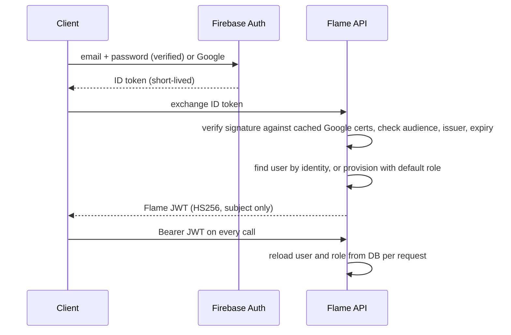
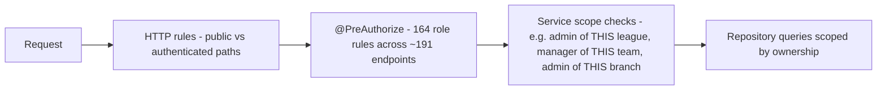

# 08 — Security Model

## Principles

1. **The API is the only authority.** Client-side guards improve usability; they are never relied on for protection.
2. **Defence in depth.** Authorisation is checked at the HTTP layer, at the method level, and again inside services.
3. **No standing credentials.** No secrets live in code, images or CI; deploys use short-lived OIDC credentials.
4. **Least privilege everywhere.** This covers roles, security groups, IAM policies and network paths.

## Identity and session

| Property | Implementation |
|---|---|
| Identity proofing | Firebase Authentication (email verification, Google federation) |
| Session token | Flame-issued JWT; signing key from Secrets Manager |
| Token contents | Subject only. Roles are **not** embedded, so role changes and revocations apply on the next request |
| Storage | Web: `sessionStorage`, cleared when the tab closes. Mobile: OS keychain or keystore through SecureStore |
| Expiry handling | A 401 clears local state and routes to login |
| Session restore | On startup the stored token is validated by fetching the current user, with a timeout safeguard |

## Authorisation layers

| Layer | Example |
|---|---|
| HTTP | Auth exchange, public marketplace browsing and surveys are open; everything else requires authentication |
| Method | Generating fixtures requires `super_admin` or `league_admin` |
| Service | A league admin may only generate fixtures for seasons in divisions of **their** league |
| Capability | Branch-admin operations require the `referee` role **and** an active branch-admin assignment for that branch |

### Capability-based sub-roles

Instead of adding a new role value for every organisational hat, sub-roles are derived from assignment records:

| Capability | Base role | Derived from |
|---|---|---|
| Branch admin | referee | Branch-admin assignment for a specific branch |
| Mother-body admin | referee | Mother-body admin assignment; **read-only** across child branches |
| Store owner | any | Ownership of an approved marketplace store |
| League admin of league X | league_admin | League-admin assignment for league X |
| Full finance access | league_admin | A finance access level on the league-admin assignment |

This keeps the role enum small and makes "dual hats" (for example, a referee who is also a branch admin) natural. A mother-body admin's read access never grants write access.

## Data integrity and audit

- **Mandatory reasons** for waivers and sanction adjustments
- **Append-only finance audit log** recording actor, action, before and after state, and reason
- **Idempotency keys** on system-generated fines and sanctions, so replays never double-apply
- **Server-side gates**: a season cannot start while policy readiness fails, and suspended players cannot be submitted in lineups
- **Opponent lineup privacy**: hidden until both teams submit or kick-off passes, unless the viewer is an official

## Secrets and infrastructure

| Area | Control |
|---|---|
| Application secrets | Secrets Manager, injected into the ECS task as environment variables at runtime |
| Startup | No fallback secrets: the service refuses to start without its required configuration |
| CI | GitHub OIDC; each pipeline assumes a narrowly scoped deploy role |
| Network | Private subnets; security groups chained ALB, then ECS, then RDS, EFS and endpoints; no NAT; no SSH (SSM only) |
| Storage | RDS and EFS encrypted at rest; S3 private with OAC; TLS at CloudFront and the ALB |
| Containers | Non-root runtime user, minimal JRE base image |
| Repositories | Secret scanning; credentials, keys and environment files excluded by ignore rules |

## Secure development practices

- dependency updates are tracked; the CI typecheck and test stages run on every pull request
- the security posture is reviewed periodically, with findings tracked in a private register
- this public repository is scanned on every push with gitleaks and a private redaction deny-list ([SECURITY.md](../SECURITY.md))

Prev: [07 — Cloud and DevOps](07-cloud-and-devops.md) · Next: [09 — Engineering metrics](09-engineering-metrics.md)
