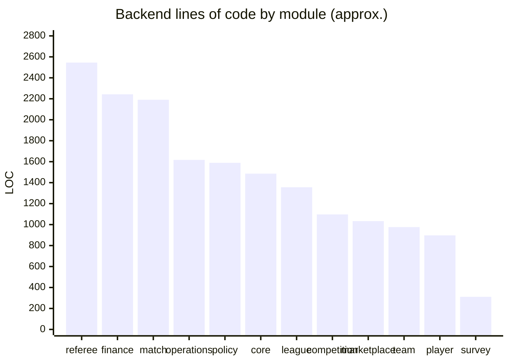

# 09 — Engineering Metrics

Size and complexity indicators, measured from the private repositories with [`scripts/collect-metrics.mjs`](../scripts/collect-metrics.mjs). The script prints counts only. Snapshot: **October 2026**.

## Headline numbers

| Metric | Value |
|---|---:|
| Bounded contexts | **12 + core config** |
| JPA entities | **53** |
| REST endpoints | **191** |
| Method-level authorisation rules (`@PreAuthorize`) | **164** |
| Web pages | **48** |
| Mobile screens | **48** |
| Shared data hooks (web + mobile) | **149** |
| Shared domain types | **165** |
| Platform roles / capability sub-roles | **5 / 5** |
| Scheduled operational jobs | **4** |

## Frontend

| Metric | Value |
|---|---:|
| TypeScript lines, apps + shared packages | 44,000 |
| Web app | 30,000 |
| Mobile app | 8,500 |
| Shared packages | 5,500 |
| Web routes (public + authenticated) | ~50 (6 public, ~44 under the app shell) |
| Role-guarded web routes | 13 |
| Mobile tabs / stack screens | 6 / 37 (18 role-guarded) |
| Shared API modules | 17 |
| Forms / Zod schemas | 18 / 14 |
| Largest UI units | Team registration modal, lineup pitch board, branch admin dashboard, policy wizard, season management (600–775 lines each) |

## Backend

| Metric | Value |
|---|---:|
| Java lines (main) | 20,600 (17,400 non-blank) |
| Java source files | 380 |
| Controllers / services / repositories | 39 / 49 / 53 |
| DTOs / enums | 122 / 50 |
| PostgreSQL schemas | 11 |
| Versioned SQL migration scripts | 14 |
| Test methods | 22, focused on scheduling and capacity rules |

### Size by module

## Delivery

| Metric | Value |
|---|---:|
| Commits (frontend / backend) | 73 / 48 |
| Active development window | May – October 2026 |
| Deployable artefacts | 3 (web SPA, mobile app, API container) |
| CI pipelines | 2 (API: test, build, deploy; Web: typecheck, build, deploy) |
| Terraform resource files | 16 |
| Environments | Production, local Docker Compose |

## Complexity hot spots

These are the areas where the most business rules meet:

| Area | Why it is complex |
|---|---|
| **Match report submission** | One transaction updates standings, player statistics, performance tokens, sanctions and card fines, and it has to be idempotent |
| **Policy readiness** | Three-level rule resolution, about a dozen rule keys, per-team evaluation, waivers, and a hard gate on season start |
| **Discipline engine** | Double yellow counts as red, season yellow accumulation, suspensions that include the current match, admin overrides with audit |
| **Match-week readiness** | Eight check keys across four contexts, deadline-relative evaluation, role-scoped views |
| **Referee operations** | Two capability tiers (branch, mother body), four appointment roles, fee accruals that separate branch revenue from referee earnings |
| **Lineups** | Formation templates, eligibility blockers, deadline locks, opponent privacy |

Prev: [08 — Security model](08-security-model.md) · Back to [README](../README.md)
