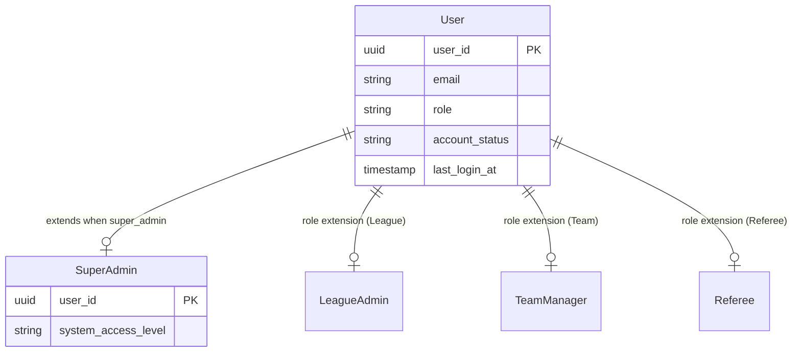
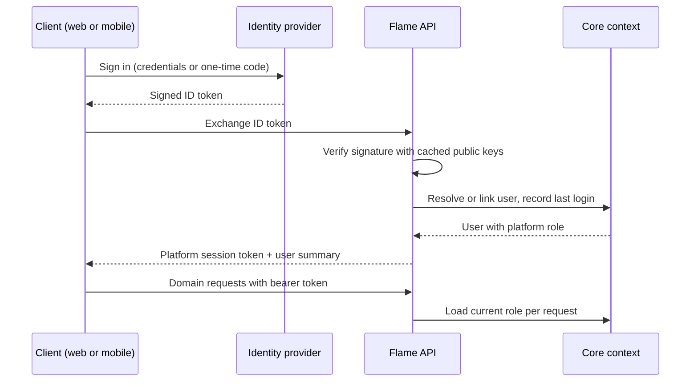

# Domain 00 — Core

Core is the identity backbone of Flame. It owns who a person is, how they prove it, and which coarse-grained role they hold on the platform. Every other bounded context refers to a Core user as its identity anchor, and every elevated capability (league administration, team management, officiating, store ownership) is layered on top of a Core identity rather than duplicated inside another context.

## Responsibilities

- Register accounts and authenticate users through a federated identity provider, exchanging verified provider tokens for a short-lived platform session token.
- Maintain user profiles, profile photos and account lifecycle status.
- Hold the single platform role per user that drives API authorisation and client navigation.
- Provide federation-wide user governance for super administrators.
- Act as the upstream identity provider for every role extension in downstream contexts.

## Ubiquitous language

| Term | Meaning |
|---|---|
| User | A registered person with exactly one platform role and an account status |
| Platform role | Coarse-grained role: `super_admin`, `league_admin`, `team_manager`, `referee` or `user` |
| Account status | Lifecycle state of an account: active, suspended, inactive or locked |
| Super admin | Federation-wide governor; optionally carries a system access level (full or audit-only) |
| Role extension | A record in another context (for example a league admin assignment) that grants scoped capabilities and may promote the platform role |
| Session token | Stateless bearer token issued by the platform after identity verification; roles are resolved on each request |

## Model

## Key workflows

- **Sign up.** A visitor verifies their identity with the identity provider and creates an account. New accounts always start as `user`; elevated roles are never self-selected.
- **Sign in and token exchange.** The client obtains an ID token from the identity provider and presents it to the backend. The backend verifies the signature against cached provider public keys, resolves or links the Core user, and issues a platform session token used for all subsequent API calls.
- **Session restore.** On launch, web and mobile clients rehydrate the stored session, fetch the current user profile and route to the role-appropriate dashboard, or fall back to sign-in if the session is no longer valid.
- **Role promotion.** Downstream contexts promote a user when an assignment is approved (for example a super admin approving a team manager nomination). The new role takes effect on the next authenticated request because roles are never baked into the token.
- **User governance.** Super admins search, edit, change the role of, suspend or remove accounts from a single management console.

## Business rules & invariants

- Email addresses are unique across the platform; phone numbers are normalised to a canonical international format before matching.
- Self-service registration can only ever produce the `user` role. The `super_admin` role cannot be granted through the standard role-change capability.
- A user holds exactly one platform role at a time; finer-grained capabilities (branch admin, store owner) are modelled as extensions, not extra roles.
- Session tokens carry identity only. Authorisation is evaluated against the current database role on every request, so promotions and demotions apply immediately.
- Changing a user's role through governance keeps the related extension records (super admin, league admin, team manager) in sync.

## Access control

| Capability | Roles |
|---|---|
| Register, sign in, restore session | Public / any authenticated user |
| View and edit own profile, upload photo | super_admin, league_admin, team_manager, referee, user |
| Look up a user by email | super_admin, league_admin |
| List all users | super_admin |
| Edit, change role, suspend or delete users | super_admin |

## Integration points

| Context | Relationship |
|---|---|
| League | League admin assignment promotes a user to `league_admin` |
| Team | Approved team manager nomination promotes a user to `team_manager` |
| Referee | Approved referee registration promotes a user to `referee`; branch admin is a capability on top |
| Marketplace | Store ownership is linked to a Core user without changing their role |
| Operations | Notifications are addressed to Core users |
| All contexts | Audit fields (created by, approved by, assigned by) reference Core users |

## Engineering notes

- **Federated identity, platform authorisation.** Identity verification is delegated to a managed provider, while authorisation stays entirely inside the platform. Provider public keys are cached so token verification does not add a network round trip per sign-in.
- **Role-per-request resolution.** Keeping roles out of the token trades one indexed lookup per request for instant, revocation-safe role changes.
- **Shared auth state.** A single platform-agnostic auth provider is reused by the web and mobile apps, with storage and navigation injected per platform.
- **UUID identity keys** are used everywhere, so identifiers are safe to expose to clients and can be generated without coordination.

---

**Next:** [Domain 01 — League](01-league.md) | **Up:** [Domain model](../04-domain-model.md)
