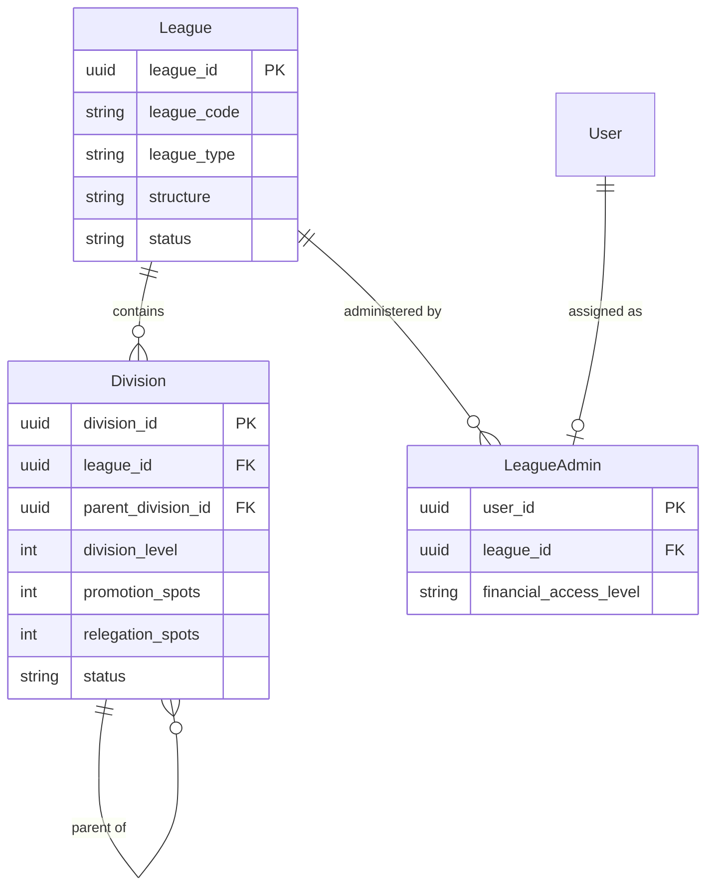
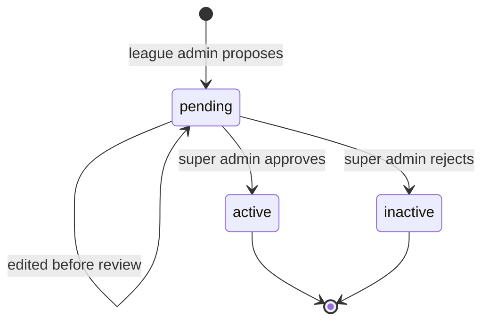

# Domain 01 — League

The League context models how football is governed: competition bodies, the division structures beneath them, and the administrators who run them day to day. It is the organisational anchor for most of the platform and sits upstream of Team, Competition, Policy and Referee. A league such as the fictional "Northern Provincial League" might run a flat single-tier structure, a promotion and relegation pyramid, or a set of regional conferences, and the model accommodates all three.

## Responsibilities

- Register and maintain leagues, each identified by a platform-wide unique code.
- Model multi-level division hierarchies (flat, pyramid or conference).
- Assign league administrators and record their capability profile.
- Gate new divisions through a federation approval workflow.
- Provide the scope for teams, seasons, policy packs and referee coverage.

## Ubiquitous language

| Term | Meaning |
|---|---|
| League | A governed football body with a type (professional, amateur, youth or academy) and a status |
| League structure | The overall hierarchy model: flat, pyramid or conference |
| Division | A tier within a league; may have a parent division to form a pyramid |
| Division level | Numeric tier position used for ordering and promotion/relegation |
| Division status | Approval lifecycle: pending, then active or inactive |
| League admin | A user assigned to administer one league, with capability flags and a financial access level |
| Sorting rules | Division-level configuration for standings tie-break preferences |

## Model

## Key workflows

- **Register a league.** A super admin creates a league with a unique code, type and structure. Sensible defaults (amateur, flat, active) keep onboarding fast.
- **Assign a league admin.** A super admin delegates a league to a user. The assignment promotes the user to `league_admin`, and their navigation and dashboard switch to league operations on the next request.
- **Propose and approve divisions.** League admins propose new tiers, which always start as pending. While pending they can be refined; a super admin then approves (active) or rejects (inactive) them.
- **Browse the structure.** Team managers and referees navigate the division tree to reach seasons, fixtures and standings. The tree is assembled client-side from a flat list using parent references.

## Business rules & invariants

- League codes are unique across the platform; division codes are unique within their league.
- A parent division must belong to the same league as its child, which keeps hierarchies from crossing organisational boundaries.
- Newly proposed divisions are always pending, and only pending divisions are editable by league admins.
- Each division declares team capacity bounds (minimum and maximum teams) and promotion and relegation spots that feed season planning.
- A user administers at most one league at a time.

## Access control

| Capability | Roles |
|---|---|
| Create, update or delete leagues | super_admin |
| Assign or remove league admins | super_admin |
| View own league dashboard | league_admin |
| Propose and edit pending divisions | league_admin, super_admin |
| Approve or reject divisions | super_admin |
| Browse leagues and division trees | super_admin, league_admin, team_manager, referee |

## Integration points

| Context | Relationship |
|---|---|
| Core | League admin assignment promotes the user's platform role |
| Team | Teams register into a league and optionally a division |
| Competition | Seasons are hosted by divisions |
| Policy | Each league owns a policy pack that divisions and seasons inherit or override |
| Referee | Referee branches are linked to the leagues and divisions they serve |
| Finance & Discipline | Admin financial access level governs fee and fine visibility |

## Engineering notes

- **Self-referencing hierarchy.** A single parent reference on divisions supports flat, pyramid and conference models without separate tables per structure.
- **JSONB configuration.** Standings tie-break rules and division configuration are stored as JSONB, so leagues can evolve their rules without schema migrations.
- **Approval as a first-class state.** Modelling approval in the division lifecycle, instead of in a side table, keeps queries simple: every consumer filters on status.
- **Cache invalidation by scope.** Shared data hooks invalidate league, division and pending-approval caches together, so web and mobile views stay consistent after any change.

---

**Prev:** [Domain 00 — Core](00-core.md) | **Next:** [Domain 02 — Competition](02-competition.md) | **Up:** [Domain model](../04-domain-model.md)
