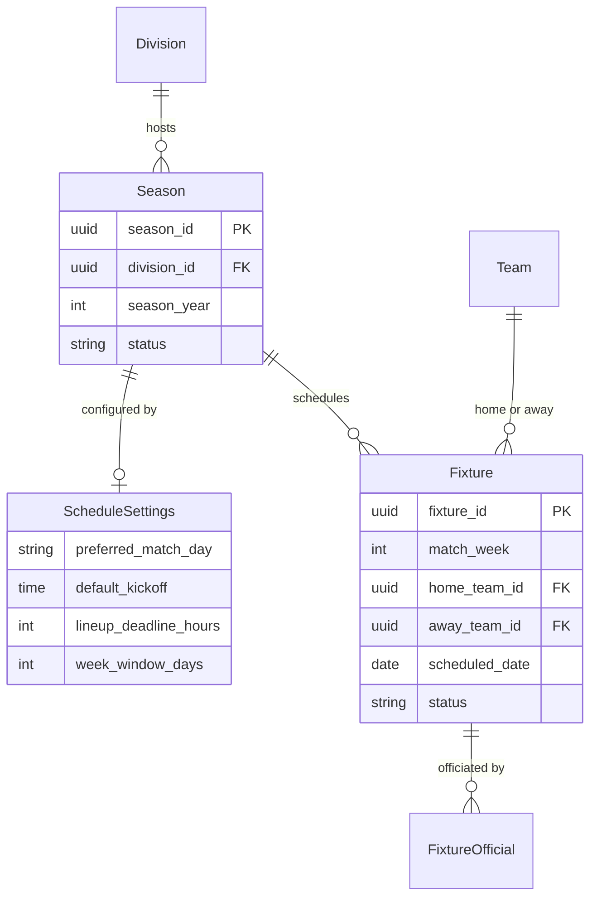
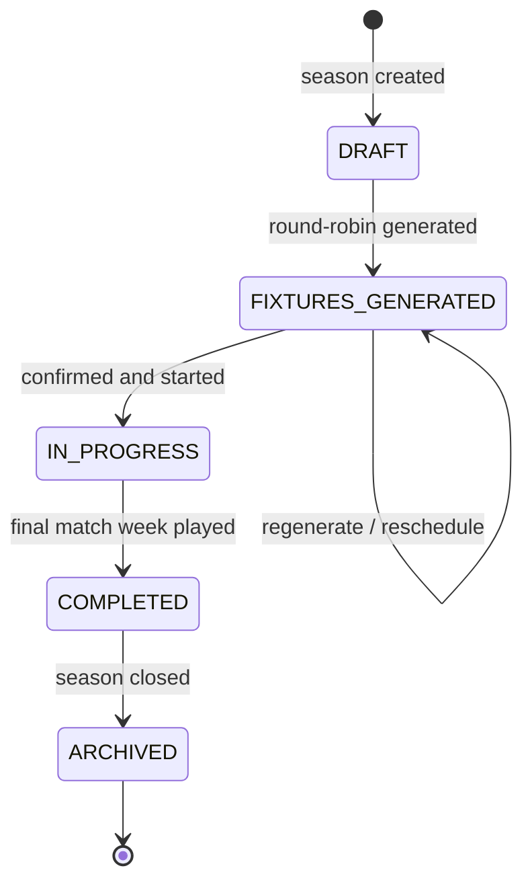

# Domain 02 — Competition

Competition turns a division into a playable calendar. It owns seasons, the round-robin fixture generator, fixture scheduling and the operational timing settings that every match week runs on. It is downstream of League and upstream of Match, Operations, Policy and Referee: lineups, reports, standings, appointments and readiness checks all hang off the fixtures created here.

## Responsibilities

- Create seasons within divisions and manage their lifecycle.
- Generate single- or double-leg round-robin fixture lists from the division's active teams.
- Schedule fixtures manually or in bulk with an auto-scheduler.
- Define match-week windows and the operational deadlines derived from them (lineup lock, referee appointment, report due).
- Serve fixture data to the match-day, officiating and readiness contexts.

## Ubiquitous language

| Term | Meaning |
|---|---|
| Season | One competition cycle of a division, unique per division and year |
| Fixture | A scheduled match between a home and an away team within a match week |
| Match week | The round index that groups fixtures for scheduling and readiness |
| Week window | The date range in which a match week's fixtures may be played |
| Generation type | Single round-robin (each pair meets once) or double round-robin (home and away) |
| Schedule settings | Preferred match day, default kick-off time, deadline offsets and window length for a season |
| Bye | A rest week for one team when the division has an odd number of teams |

## Model

## Key workflows

- **Create a season.** A league admin opens a new season for one of their divisions. It starts in draft so structure can be prepared before anything is published.
- **Generate fixtures.** The `RoundRobinScheduler` builds the full fixture list using the circle method. Odd team counts are padded with a bye, an optional seed makes the draw reproducible, and the number of match weeks is always legs multiplied by (even team count minus one). Regenerating replaces the previous draft fixture list.
- **Configure schedule settings.** Admins set the preferred match day, default kick-off, week window length and deadline offsets. These values drive lineup locking, referee gap alerts and overdue report notifications in other contexts.
- **Auto-schedule.** The scheduler places unscheduled fixtures (or a single match week) on the preferred day inside each week window, staggering kick-off slots and spilling into later days of the window when a day is full. Existing dates are preserved unless an overwrite is requested.
- **Manual scheduling.** Individual fixtures can be moved, with validation that the new date stays inside the fixture's match-week window.

## Business rules & invariants

- A division can have only one season per year.
- Fixture generation requires at least two active teams in the division.
- Every team plays every other team exactly once per leg; in a double round-robin the second leg reverses home and away.
- A fixture's scheduled date must fall within its match-week window.
- Fixture status moves through scheduled, played, postponed or cancelled; scores are written only by submitted match reports.
- Season start is presented alongside the Policy context's readiness assessment, so admins can see outstanding compliance blockers before confirming.

## Access control

| Capability | Roles |
|---|---|
| Create seasons, generate and schedule fixtures | super_admin, league_admin |
| Edit schedule settings, change season status | super_admin, league_admin |
| View seasons, fixtures and week windows | super_admin, league_admin, team_manager, referee |
| View fixtures and results via standings | user |

## Integration points

| Context | Relationship |
|---|---|
| League | Seasons belong to divisions; league admin scope is resolved through the division's league |
| Team | Generation draws on the division's active teams |
| Match | Lineups, reports, standings and statistics are keyed on fixtures and seasons |
| Policy | Season readiness is assessed against the resolved policy pack before start |
| Operations | Week windows and deadline offsets feed match-week readiness and scheduled jobs |
| Referee | Officials are appointed to fixtures in defined roles |

## Engineering notes

- **Deterministic generation.** A seedable circle-method scheduler means a draw can be reproduced exactly, which is valuable when a federation needs to audit or re-run it.
- **Settings over code.** Deadlines are expressed as offsets on the season rather than constants, so one league can lock lineups an hour before kick-off and another a day before, with no code change.
- **JSONB generation config** records how a season's fixtures were produced alongside the season itself.
- **Coordinated cache invalidation.** Generating or rescheduling fixtures invalidates fixture, match-week and readiness queries together in the shared hooks layer used by both clients.

---

**Prev:** [Domain 01 — League](01-league.md) | **Next:** [Domain 03 — Team](03-team.md) | **Up:** [Domain model](../04-domain-model.md)
