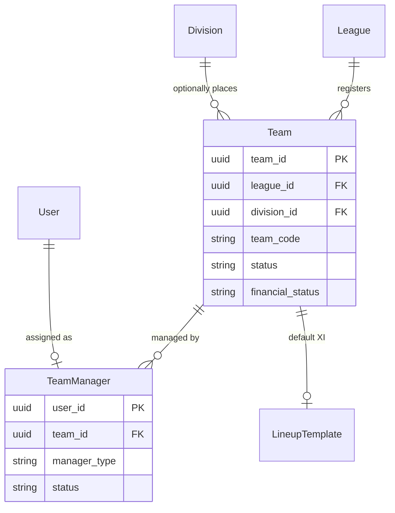
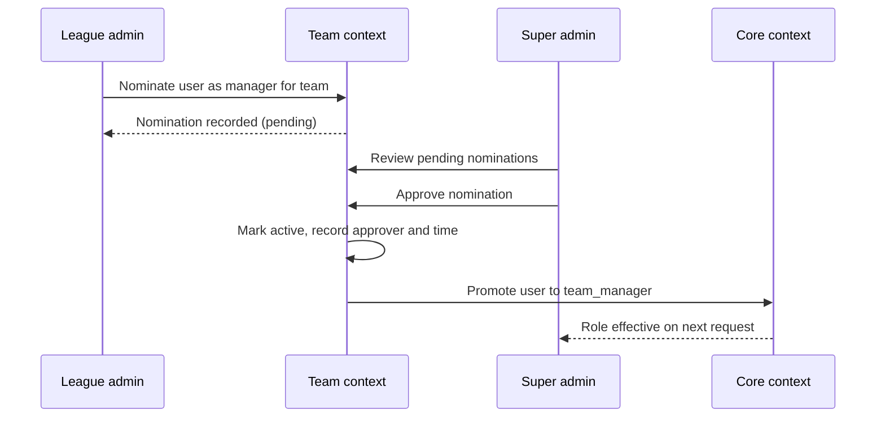

# Domain 03 — Team

The Team context represents the clubs that take part in competition. It owns club registration and branding, sporting and financial standing, and the nomination workflow that puts a responsible manager in charge of each squad. A club such as the fictional "Riverside FC" is registered into a league, optionally placed in a division, and from then on becomes the scope for its roster, lineups, readiness checks and match-week operations.

## Responsibilities

- Register clubs within a league and, optionally, a division.
- Maintain team identity: name, short name, code, home ground and logo.
- Track sporting status and financial standing.
- Run the team manager nomination and approval workflow.
- Provide the team scope for rosters, lineups, lineup templates and readiness.

## Ubiquitous language

| Term | Meaning |
|---|---|
| Team | A registered club within a league, with optional division placement |
| Team code | Short identifier, unique within the team's league |
| Team status | Sporting standing: active, inactive, suspended or banned |
| Financial status | Financial standing: solvent, watch or embargo |
| Team manager | A user authorised to run the squad and match-day operations for one team |
| Manager type | Head manager or assistant manager |
| Manager status | Nomination lifecycle: pending, then active or rejected |
| Lineup template | A team's default starting eleven, reused to pre-fill new match lineups |

## Model

## Key workflows

- **Register a club.** A league admin registers a team with a code unique to the league and, if appropriate, a division that belongs to the same league.
- **Nominate a manager.** A league admin nominates an existing user (found by email) as head or assistant manager. The nomination is created as pending and appears in the super admin approval queue.
- **Approve or reject.** On approval the nomination becomes active, the approver and timestamp are recorded, and the user is promoted to `team_manager`. Their next session lands on the My Team hub.
- **Manage the club profile.** Active managers maintain their own team's profile and logo; league admins can update any team in their league.
- **Flag standing.** League admins can suspend a team or move it between solvent, watch and embargo, giving league operations a single, visible signal of each club's standing.

## Business rules & invariants

- Team codes are unique within a league; a team's division must belong to the team's league.
- A user can hold at most one manager assignment at a time, which keeps "my team" unambiguous across web and mobile.
- Only active manager assignments grant team-scoped capabilities; pending and rejected nominations grant nothing.
- League admins can nominate managers only for teams in a league they administer.
- Manager assignments carry capability flags (roster management, financial visibility, league communication) alongside the manager type.
- Only active teams in a division are drawn into fixture generation.

## Access control

| Capability | Roles |
|---|---|
| Register a team, change status or financial standing | league_admin, super_admin |
| Edit team profile and upload logo | league_admin, super_admin, team_manager (own team) |
| Nominate a team manager | league_admin |
| Approve or reject manager nominations | super_admin |
| View own team hub | team_manager |
| Delete a team | super_admin |
| Browse teams | super_admin, league_admin, team_manager, referee, user |

## Integration points

| Context | Relationship |
|---|---|
| Core | Approved nominations promote the user's platform role |
| League | Teams belong to a league and optionally a division |
| Competition | Active teams in a division feed round-robin generation |
| Player | Contracts link players to a team's roster |
| Match | Lineups are submitted per team per fixture; templates pre-fill them |
| Policy | Team season readiness evaluates squad and compliance rules per team |
| Operations | The My Team hub surfaces fixture-level operational status |

## Engineering notes

- **Composed team hub.** The My Team screen composes cards from several contexts (fixtures, readiness, lineups) through shared data hooks, so the web and mobile hubs show the same state from the same queries.
- **Two-step trust model.** Splitting nomination (league level) from approval (federation level) keeps role elevation under central control without slowing down league operations.
- **Context ownership over storage.** Lineup templates live alongside team data but are owned by the Match context's logic, a deliberate split between where data is stored and who governs it.
- **UUID keys and JSONB metadata** keep team records extensible for future club attributes without schema churn.

---

**Prev:** [Domain 02 — Competition](02-competition.md) | **Next:** [Domain 04 — Player](04-player.md) | **Up:** [Domain model](../04-domain-model.md)
