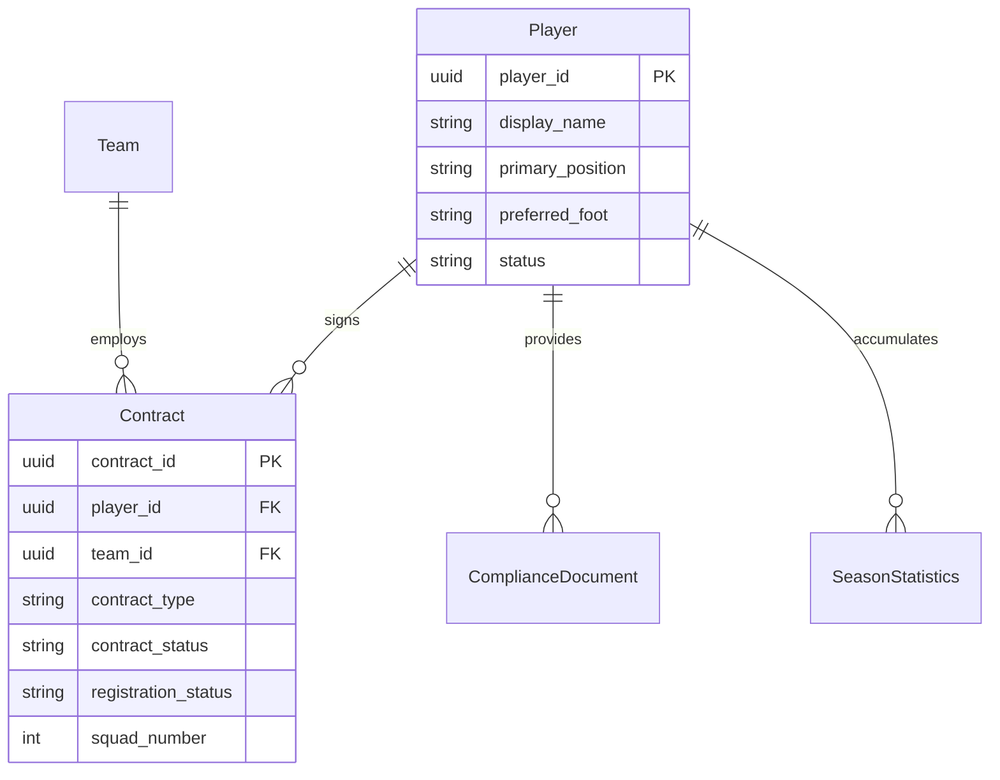
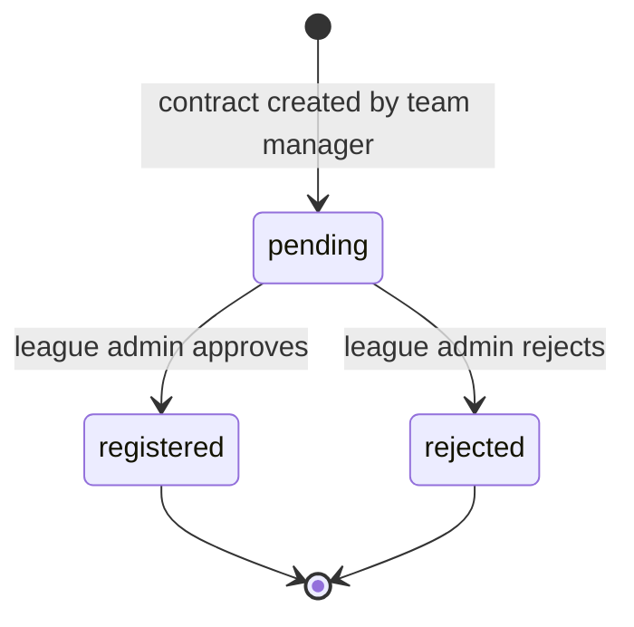

# Domain 04 — Player

The Player context is Flame's centralised player registry. A player exists as an independent identity, separate from any club, and is linked to teams through contracts that must be registered by the league before the player can take the field. This separation is what lets the platform follow a player across clubs and seasons, and it is the foundation for eligibility, compliance, statistics and scouting.

## Responsibilities

- Maintain player identities and sporting profiles in a single registry.
- Link players to teams through contracts with type, term and squad number.
- Gate contract registration through league-admin approval.
- Expose each team's roster with per-player eligibility for lineup selection.
- Notify compliance readiness whenever player or contract data changes.

## Ubiquitous language

| Term | Meaning |
|---|---|
| Player | A registered individual in the registry, independent of any club |
| Position | Primary position (goalkeeper, defender, midfielder, forward) plus optional secondary positions |
| Contract | An agreement linking a player to a team for a period, with a squad number |
| Contract type | Professional, amateur, academy or loan |
| Contract status | Active, expired or terminated |
| Registration status | League gate on a contract: pending, registered, rejected or unregistered |
| Eligible player | A player with an active contract that the league has registered |
| Player blocker | A failed compliance or eligibility check that prevents match selection |

## Model

## Key workflows

- **Register a player.** A team manager creates a player identity (names, date of birth, nationality, positions, preferred foot) and uploads a profile photo.
- **Offer a contract.** The manager links the player to their team with a contract type, term and squad number. The contract is active immediately but its registration is pending.
- **League registration.** League admins work through a queue of pending contracts across their league and register or reject each one. The approver and time are recorded.
- **Roster with eligibility.** Each team's roster is returned with an eligibility flag and human-readable blockers, so managers see exactly why a player cannot be selected (for example "registration pending" or "document missing").
- **Compliance documents.** Required documents, such as proof of identity, are uploaded per player and reviewed by league admins in the Policy context.

## Business rules & invariants

- A player cannot hold two active or pending contracts with the same team at once.
- A player is eligible for selection only when their contract is active and registered; eligibility is evaluated server-side and mirrored client-side for instant feedback.
- Registration decisions are recorded with the approving administrator and timestamp for auditability.
- Player, photo, contract and document changes refresh team and season readiness, so compliance status never lags behind the roster.
- Blocker evaluation is shared logic: the same rules power roster chips, lineup pickers and roster filters on both web and mobile.

## Access control

| Capability | Roles |
|---|---|
| Create and edit players, create contracts | team_manager |
| Upload player photos | team_manager, league_admin, super_admin |
| View team roster with eligibility | team_manager, league_admin, super_admin |
| Register or reject contracts | league_admin |
| Review compliance documents | league_admin |
| View a player record for match reports | referee |
| Delete a player | super_admin |
| View statistics and scouting rankings | super_admin, league_admin, team_manager, referee |

## Integration points

| Context | Relationship |
|---|---|
| Team | Contracts are scoped to a team's roster |
| Policy | Documents and contract registration feed season and team readiness |
| Match | Eligible players populate lineups; events and tokens reference players |
| Finance & Discipline | Suspensions and player-billed fines attach to player identities |
| Operations | Lineup readiness depends on having enough eligible players |

## Engineering notes

- **Identity separate from employment.** Modelling the player and the contract as distinct aggregates keeps history intact through transfers and loans and avoids duplicating people per club.
- **Shared blocker utilities.** Eligibility and blocker messaging live in the shared TypeScript layer as pure functions, so every surface explains a blocker in the same words.
- **Readiness-aware mutations.** Player and contract mutations in the shared hooks invalidate readiness queries automatically, keeping compliance dashboards current without manual refresh.
- **JSONB for variable attributes.** Secondary positions and extended profile metadata are stored as JSONB, avoiding sparse columns.

---

**Prev:** [Domain 03 — Team](03-team.md) | **Next:** [Domain 05 — Match](05-match.md) | **Up:** [Domain model](../04-domain-model.md)
