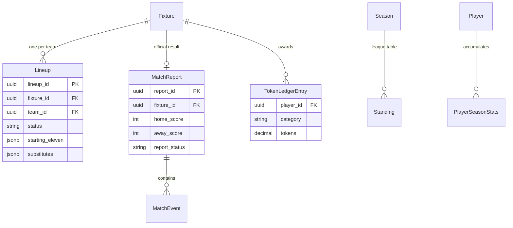
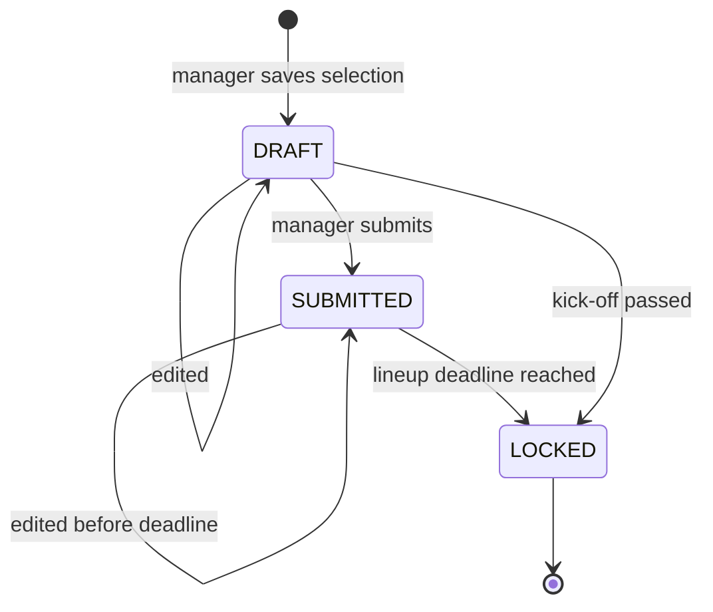

# Domain 05 — Match

Match is where the season actually happens. It covers everything from the moment a manager picks a squad to the moment the league table updates: lineups with deadline locking and opponent privacy, referee match reports with timed events, standings, player statistics, and a performance-token model that powers scouting rankings. It has its own module in the backend while sharing the competition data schema, because every artefact it produces is keyed on a fixture and a season.

## Responsibilities

- Let team managers draft, submit and template lineups for each fixture.
- Lock lineups at a configurable deadline and protect opponent lineups until it is fair to reveal them.
- Capture official results and match events through referee reports.
- Maintain league standings, team and player season statistics.
- Award performance tokens and produce scouting rankings.

## Ubiquitous language

| Term | Meaning |
|---|---|
| Lineup | A team's starting eleven, substitutes and staff for one fixture |
| Lineup status | Draft, submitted, confirmed or locked |
| Lineup template | A team's default eleven used to pre-fill new lineups |
| Match report | The referee's official record of score, conditions and events; draft, submitted or verified |
| Match event | A timed occurrence: goal, assist, penalty scored or missed, own goal, yellow or red card, substitution |
| Standing | A team's row in the season table: played, won, drawn, lost, goals, goal difference, points |
| Performance token | A weighted award for a contribution such as starting, coming on, scoring or keeping a clean sheet |
| Scout score | A normalised token rating used to rank players for talent identification |

## Model

## Key workflows

- **Build a lineup.** The manager opens a fixture and starts from the team template or the last submitted lineup, then arranges players on a pitch-board editor. Only eligible players can be selected.
- **Submit and lock.** Submission makes the lineup official. The `LineupLockService` then blocks edits once the lock deadline passes, persisting the locked state; a scheduled job in Operations applies the same rule proactively.
- **Opponent privacy.** A team sees its opponent's lineup only once both sides have submitted or kick-off has passed. League admins, super admins and referees can always see both.
- **Referee report.** The appointed referee records the score, conditions and a timeline of events, then submits. Submission triggers a full, idempotent recalculation of the season's standings, statistics and performance tokens.
- **Verification.** League admins verify submitted reports, closing the loop for match-week operational readiness.

## Business rules & invariants

- Each team has at most one lineup per fixture, and each fixture has at most one official report.
- A lineup is read-only when it is explicitly locked, when the fixture has been played, when kick-off has passed, or when it is within the season's lineup deadline window after submission.
- Suspended or ineligible players cannot be included in a lineup.
- Standings award three points for a win and one for a draw, ordered by points, then goal difference, then goals scored.
- Recalculation always rebuilds the whole season from submitted and verified reports in match-week order, so results are deterministic and safe to re-run after a correction.
- Token weights are position-aware (for example clean-sheet awards for goalkeepers and defenders).
- The scout score is tokens per appearance, so players are compared on impact rather than volume; rankings can be filtered by position and a minimum appearance threshold to suppress small samples.

## Access control

| Capability | Roles |
|---|---|
| Draft, submit and template lineups | team_manager |
| View own and permitted opponent lineups | team_manager |
| View both lineups for any fixture | super_admin, league_admin, referee |
| Create, edit and submit match reports and events | referee |
| Verify match reports, trigger season recalculation | league_admin, super_admin |
| View standings | super_admin, league_admin, team_manager, referee, user |
| View player statistics and scouting rankings | super_admin, league_admin, team_manager, referee |

## Integration points

| Context | Relationship |
|---|---|
| Competition | All artefacts are keyed on fixtures and seasons; reports write fixture scores |
| Team and Player | Rosters and eligibility drive lineup selection; events reference players |
| Referee | Appointments are the entry point for report authorship |
| Operations | Lineup deadlines, lock jobs, match-week readiness and countdown banners |
| Policy | Player blockers gate lineup selection |
| Finance & Discipline | Cards on submitted reports produce fines and suspensions |

## Engineering notes

- **JSONB lineups.** Starting elevens and substitutes are stored as JSONB documents, which models formations and ordering naturally and keeps the lineup aggregate atomic.
- **Computed, then stored.** Standings and statistics are derived data, but they are materialised after each report submission so reads stay cheap while correctness comes from full recomputation.
- **Ledger-based tokens.** Every token award is a ledger entry tied to a player, fixture and category, which makes rankings explainable and auditable.
- **Invalidation cascades.** Submitting a lineup or report invalidates match-week, readiness, standings and statistics queries together in the shared hooks layer used by both the web and mobile apps.

---

**Prev:** [Domain 04 — Player](04-player.md) | **Next:** [Domain 06 — Referee](06-referee.md) | **Up:** [Domain model](../04-domain-model.md)
