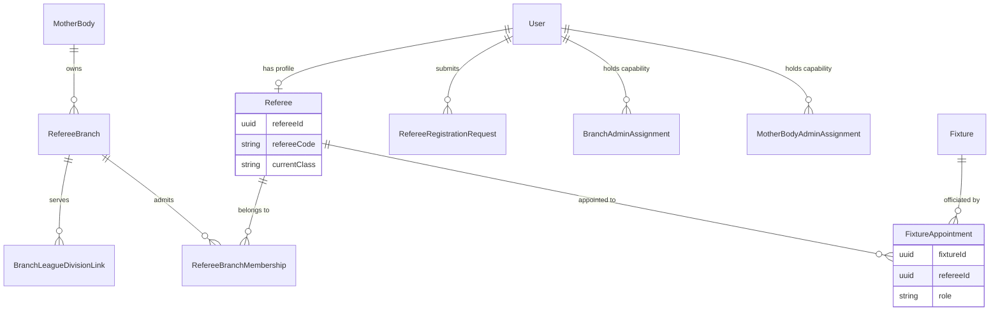
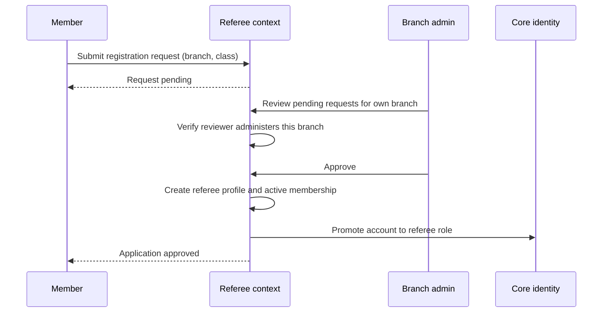

# Domain 06 — Referee

The Referee context models how match officials are organised, admitted and deployed. Referee bodies are hierarchical: a **mother body** (for example a fictional "National Referees Body") owns several regional **branches** ("Northern Branch", "Coastal Branch"), and each branch serves specific leagues and divisions. The context handles applications to join a branch, delegated branch administration, and the appointment of officials to fixtures in four distinct roles, which then drives match-day reporting.

## Responsibilities

- Maintain mother bodies and their child branches, including professional level (elite, regular, youth)
- Accept and review applications from members who want to officiate in a branch
- Grant branch-level and mother-body-level administrative capabilities without inventing new platform roles
- Link branches to the leagues and divisions they serve
- Appoint officials to fixtures as main referee, two assistants and a fourth official
- Expose each referee's appointment list as the entry point for submitting match reports

## Ubiquitous language

| Term | Meaning |
|---|---|
| Mother body | Parent referee organisation that owns one or more branches |
| Branch | Regional unit that admits, manages and appoints officials |
| Referee | Approved official with a unique referee code and a class tier (D, C, B, A) |
| Membership | A referee's standing in a branch: active, suspended or inactive |
| Registration request | A member's application to join a branch at a requested class |
| Branch admin | A referee granted write capability over one branch |
| Mother-body admin | A referee granted read-only oversight across every branch of a mother body |
| Branch link | An association between a branch and a league (optionally a division) it serves |
| Appointment | An official assigned to a fixture in one of four roles |

## Model

## Key workflows

**1. Becoming a referee.** A member applies to a branch at a requested class. A branch admin of that branch (or a super admin) approves or rejects. Approval creates the referee profile, an active membership, and promotes the account to the `referee` role in Core.

**2. Appointing officials.** From the branch dashboard, a branch admin sees fixtures in leagues the branch is linked to and assigns officials to `MAIN`, `ASSISTANT1`, `ASSISTANT2` and `FOURTH`. Re-assigning a role replaces the previous holder. Each appointment also records a match fee accrual in Finance.

**3. Delegating administration.** A super admin grants branch-admin or mother-body-admin capability to an existing referee. The client discovers these capabilities at sign-in and adds the matching navigation.

**4. Match day.** A referee opens their appointment list, acknowledges it, and moves straight into the Match context to file the report for that fixture.

## Business rules & invariants

- Only one official may hold a given role on a given fixture; assigning a role again replaces the holder rather than adding a duplicate
- The main referee role is the one Operations treats as mandatory for match-week readiness
- A user has at most one referee profile; referee codes are unique platform-wide
- Branch and mother-body administration can only be granted to accounts that already hold the `referee` role
- Branch admins act only on their own branch: reviewing its applications, appointing its referees, editing its fee schedules. Ownership is enforced in the service layer, not just in the UI
- Mother-body admins are strictly read-only: dashboards and summaries across child branches, never approvals, appointments or fee changes
- One person can hold both capabilities; write access still comes only from the branch-admin grant
- A branch can only appoint officials to fixtures in leagues and divisions it is actively linked to

## Access control

| Capability | Roles |
|---|---|
| Create, edit and retire mother bodies and branches | super_admin |
| Browse branches | super_admin, league_admin, referee, user |
| Apply to join a branch | any authenticated user |
| Approve or reject applications | super_admin; branch admin (own branch) |
| Grant branch-admin or mother-body-admin capability | super_admin |
| Link branches to leagues and divisions | super_admin |
| Appoint and remove fixture officials | branch admin (own branch) |
| View cross-branch oversight dashboards | mother-body admin (read-only), super_admin |
| View own appointments, acknowledge, file reports | referee |

## Integration points

| Context | Interaction |
|---|---|
| Core | Referee profile is tied to a user; approval changes the user's role |
| League | Branch links target leagues and divisions |
| Competition | Appointments reference fixtures and seasons |
| Match | The appointment list is the launch point for filing match reports |
| Operations | Main referee assignment is a readiness check; branch admins receive referee-gap alerts |
| Finance & Discipline | Appointments and recorded cards produce branch fee accruals |

## Engineering notes

- **Capabilities instead of extra roles.** Branch admin and mother-body admin are assignment records layered on the `referee` role, not new values in the role enum. This avoids an explosion of roles, lets one person hold several scoped grants, and keeps platform authorisation coarse while the services enforce fine-grained ownership.
- **Read-only by construction.** The mother-body admin surface only offers read operations, so oversight cannot turn into write access through a misconfigured guard.
- **Role-keyed appointments.** Using the pair of fixture and role as the natural key makes reassignment an idempotent upsert and keeps "who is the main referee?" a single lookup.
- **Fee capture at the moment of appointment.** Match fees are snapshotted when an official is appointed, so later changes to a fee schedule never rewrite history.

---

**Prev:** [Domain 05 — Match](05-match.md) | **Next:** [Domain 07 — Policy](07-policy.md) | **Up:** [Domain model](../04-domain-model.md)
