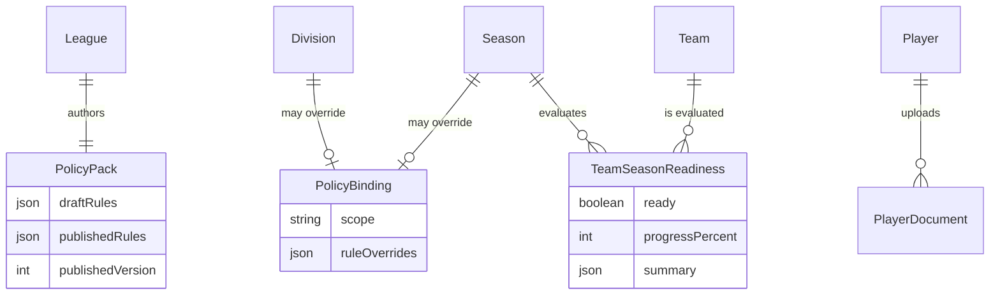
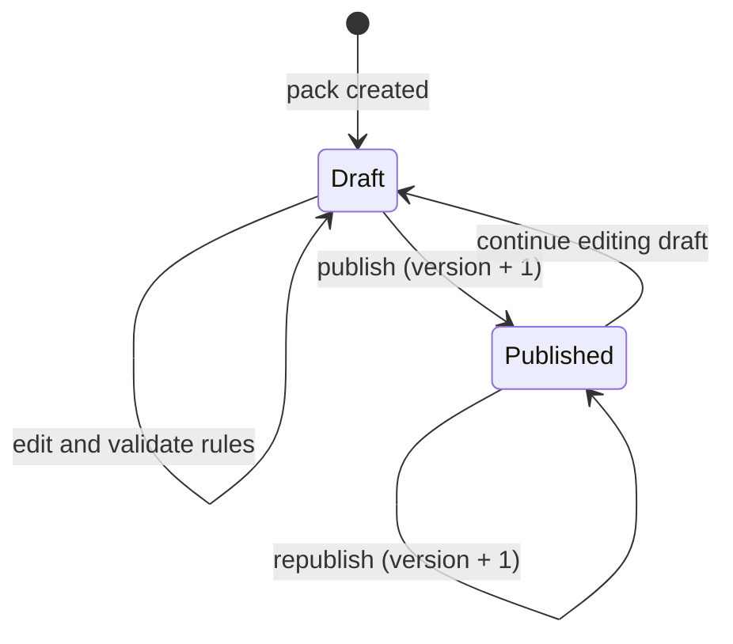

# Domain 07 — Policy

The Policy context is the governance engine of the platform. Each league authors a **policy pack**: a versioned set of rules covering squad sizes, player documents, contracts, deadlines, fees and discipline. Divisions and seasons can inherit or override those rules through **bindings**. The resolved rule set feeds the **readiness engine**, which evaluates every team against the rules and decides whether a season is allowed to start. It also drives the player-level blockers shown on rosters and lineups.

Policy readiness answers the question "is this season compliant enough to begin?". It is deliberately separate from the operational readiness in [Operations](08-operations.md), which asks "can this match week go ahead?".

## Responsibilities

- Author league policy packs as editable drafts and publish immutable, versioned snapshots
- Resolve effective rules down the hierarchy: league, then division, then season
- Validate rule parameters per rule key before they can be saved
- Collect player compliance documents and run the review workflow
- Compute per-team and season-wide readiness, with a progress score and a per-check breakdown
- Supply player blockers (missing documents, unregistered contract, suspension) to roster and lineup flows

## Ubiquitous language

| Term | Meaning |
|---|---|
| Policy pack | A league's rule set, held as a working draft plus the last published version |
| Binding | A division-level or season-level override of the inherited rules |
| Rule key | A named check such as minimum registered contracts or required document types |
| Severity | `blocking` (gates season start) or `warning` (shown, not enforced) |
| Check status | Result of one check: `met`, `unmet`, `waived` or `not_applicable` |
| Team readiness | One team's checklist and progress for a season |
| Season readiness | Aggregate of all teams plus division-level checks |
| Player document | An uploaded compliance artefact (national ID, passport, medical clearance, parental consent) |
| Player blocker | A reason a specific player cannot be fielded |

## Model

Representative rule keys: division team count bounds, team assigned to a division, minimum registered contracts, maximum squad size, complete player profile, player photo required, required document types approved, all contracts registered, registration deadline, participation fee paid, and the finance and discipline rule family described in [Finance & Discipline](11-finance-discipline.md).

## Key workflows

**1. Draft and publish.** A league admin edits the draft, starting from a preset or from scratch. Each rule is validated against its parameter schema. Publishing copies the draft into the published slot and increments the version, so enforcement only ever reads published rules.

**2. Hierarchical resolution.** To evaluate a season, the engine takes the league's published rules, applies the division binding, then the season binding. Each layer either inherits a rule unchanged or overrides it, so a youth division can relax squad limits without forking the whole league pack.

**3. Season readiness and the start gate.** The engine evaluates every resolved rule for every team, producing a status per check and a progress percentage. A season can only move to in-progress when no `blocking` check is `unmet`.

**4. Document review.** A team manager uploads a document for a player. It enters a league-wide pending queue, where a league admin approves or rejects it. Approval can flip document checks from `unmet` to `met` on the next evaluation.

**5. Player blockers.** The same rule outcomes are projected per player, so roster and lineup screens can show why a player is not match-ready before the manager tries to select them.

## Business rules & invariants

- Exactly one policy pack per league; a pack with no rules cannot be published
- Published versions only move forward; enforcement never reads draft rules
- Overrides resolve from most specific to least: season, then division, then league
- Rule parameters are validated per key (for example, a suspension length must be at least one match), so malformed rules are rejected when saved rather than failing at evaluation time
- Only `blocking` checks gate season start; `warning` checks inform without preventing it
- `waived` and `not_applicable` both count as passing; `waived` records an explicit admin decision, while `not_applicable` means the rule is not relevant in this context
- The start gate is enforced on the server during the season status transition, not only in the UI
- Documents move from pending to approved or rejected; only approved documents satisfy document checks

## Access control

| Capability | Roles |
|---|---|
| Edit draft, publish pack | super_admin, league_admin |
| Configure division and season bindings | super_admin, league_admin |
| View season and team readiness | super_admin, league_admin, team_manager (own team) |
| Recalculate readiness on demand | super_admin, league_admin |
| Upload player documents | team_manager, league_admin |
| Review pending documents | super_admin, league_admin |

## Integration points

| Context | Interaction |
|---|---|
| League | One pack per league; bindings attach to divisions |
| Competition | Season bindings; readiness gates the transition to in-progress |
| Team / Player | Squad size, contracts, profiles and documents are evaluated |
| Match | Player blockers constrain lineup selection |
| Finance & Discipline | Policy authors fee and discipline rules; Finance reports participation-fee status back as a readiness check |
| Operations | Shares checklist UI components but uses a separate engine |

## Engineering notes

- **Rules as structured documents.** Rules are stored as JSON documents keyed by rule key, not one table per rule type. New rule keys need a validator and an evaluator, but no schema migration.
- **Computed readiness, cached snapshot.** Readiness is always recomputed from live data, then persisted as a per-team snapshot for fast dashboards. On-demand recalculation keeps the snapshot honest.
- **Draft and published separation.** Admins can iterate safely on a live league, and the version number gives an audit anchor for "which rules were in force".
- **Status vocabulary over booleans.** Four check statuses let the UI distinguish "fixed", "excused" and "irrelevant", which a single met or unmet flag cannot express.

---

**Prev:** [Domain 06 — Referee](06-referee.md) | **Next:** [Domain 08 — Operations](08-operations.md) | **Up:** [Domain model](../04-domain-model.md)
