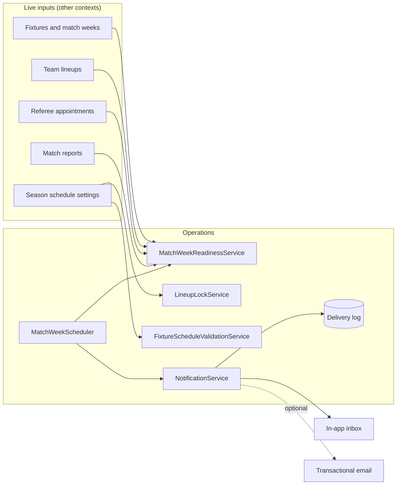
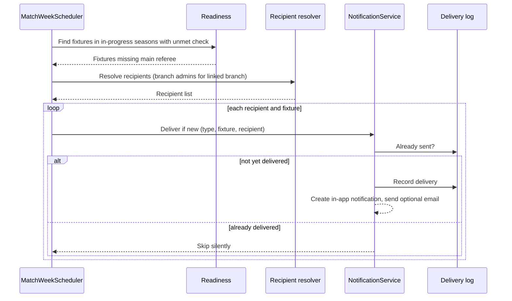

# Domain 08 — Operations

The Operations context makes match weeks run on time. It computes **operational readiness** for every fixture and match week: dates set and inside the week window, main referee appointed, both lineups submitted, report filed and verified. It runs **scheduled jobs** that chase whoever is responsible for a gap, enforces **lineup lock** deadlines, and validates fixture dates against match-week windows. Unlike policy readiness, which decides whether a season may start, operational readiness is recomputed continuously while the season is live.

## Responsibilities

- Compute fixture-level and match-week-level readiness from live competition, match and referee data
- Run four scheduled jobs that turn readiness gaps into targeted notifications
- Deliver in-app notifications with strict de-duplication, plus optional transactional email
- Lock lineups at a configurable deadline before kick-off
- Reject fixture dates that fall outside their match-week window
- Supply readiness widgets embedded in season, team and branch-admin screens

## Ubiquitous language

| Term | Meaning |
|---|---|
| Match week | A numbered round of fixtures with a start and end date window |
| Operational check | A single readiness condition evaluated for a fixture or week |
| Readiness progress | Blocking checks passed divided by total blocking checks |
| Lineup lock | The point after which a lineup can no longer be saved or submitted |
| Lock reason | Why a lineup is locked: deadline passed, kick-off passed, match played, or locked explicitly |
| Notification | An in-app message to one recipient, optionally linked to a fixture, season and week |
| Delivery log | A record of which notification type was sent to whom for which fixture |

Operational check keys: `FIXTURE_DATE_SET`, `FIXTURE_DATE_IN_WEEK`, `NEXT_WEEK_DATES_SET`, `REFEREE_MAIN_ASSIGNED`, `HOME_LINEUP_SUBMITTED`, `AWAY_LINEUP_SUBMITTED`, `MATCH_REPORT_SUBMITTED`, `MATCH_REPORT_VERIFIED`.

## Model

## Key workflows

**1. Scheduled chasing.** Four jobs run on fixed schedules, each scoped to seasons that are in progress:

| Job | Schedule | Effect |
|---|---|---|
| Upcoming fixtures scan | Every 15 minutes | Lineup reminders to team managers 24 hours ahead and urgently near the deadline |
| Referee gap scan | Daily at 08:00 | Alerts branch admins when a fixture inside the appointment window has no main referee |
| Next-week scan | Daily at 09:00 | Alerts league admins when the following match week still has undated fixtures |
| Overdue report scan | Every 30 minutes | Reminds the appointed referee when a report is overdue after kick-off |

**2. Match-week dashboard.** League admins see every week with a progress bar. Fixture rows list each unmet check and link to the screen that resolves it, such as the branch-admin appointment view for a missing referee.

**3. Lineup lock.** Each save or submit asks the lock service whether the fixture is still open. Once locked, the request is rejected with a specific lock reason that the client renders as a countdown or a locked state.

**4. Fixture date validation.** Manual rescheduling and the auto-scheduler both pass through the same validator, which rejects dates outside the match-week window.

## Business rules & invariants

- A given notification type is delivered at most once per recipient per fixture, however often a job runs
- Jobs only consider seasons with in-progress status; drafts and completed seasons never generate noise
- The lock deadline comes from season schedule settings, and kick-off or a played match always locks regardless of the deadline
- Lock checks run on the server for every save and submit, so the client countdown is advisory only
- Fixture dates must fall inside their match-week window, for both manual and automatic scheduling
- Readiness progress counts only blocking checks; informational checks never lower the score
- Email is opt-in by configuration and fails soft: if it is disabled or errors, the in-app notification is still delivered

## Access control

| Capability | Roles |
|---|---|
| View all match weeks for a season | super_admin, league_admin |
| View a week's readiness | super_admin, league_admin, team_manager, referee |
| View a fixture's readiness | super_admin, league_admin, team_manager, referee |
| Configure schedule settings and lock deadline | super_admin, league_admin |
| Read and mark own notifications | any authenticated user |

## Integration points

| Context | Interaction |
|---|---|
| Competition | Fixtures, match-week windows, schedule settings, auto-scheduling |
| Match | Lineup status, lock enforcement, report submission and verification |
| Referee | Main referee appointment check; branch admins as alert recipients |
| League / Team | League admins and team managers as recipients |
| Core | Notification recipients are platform users |
| Policy | Shares checklist UI components; separate readiness engine |

## Engineering notes

- **Computed, not stored.** Readiness is derived on read from source-of-truth data, so it can never drift from reality. The only persisted state is the notifications themselves and the delivery log.
- **Delivery log as an idempotency table.** Every send goes through a single "deliver if new" path keyed on type, fixture and recipient, so jobs can run frequently and be re-run freely without users seeing duplicate messages.
- **Narrow job scope.** Restricting scans to in-progress seasons bounds the work to live competitions and keeps job cost flat as historical data grows.
- **Pluggable channels.** Email sits behind a fail-soft adapter that is disabled by default, so environments without mail configuration behave identically apart from the extra channel.

---

**Prev:** [Domain 07 — Policy](07-policy.md) | **Next:** [Domain 09 — Marketplace](09-marketplace.md) | **Up:** [Domain model](../04-domain-model.md)
