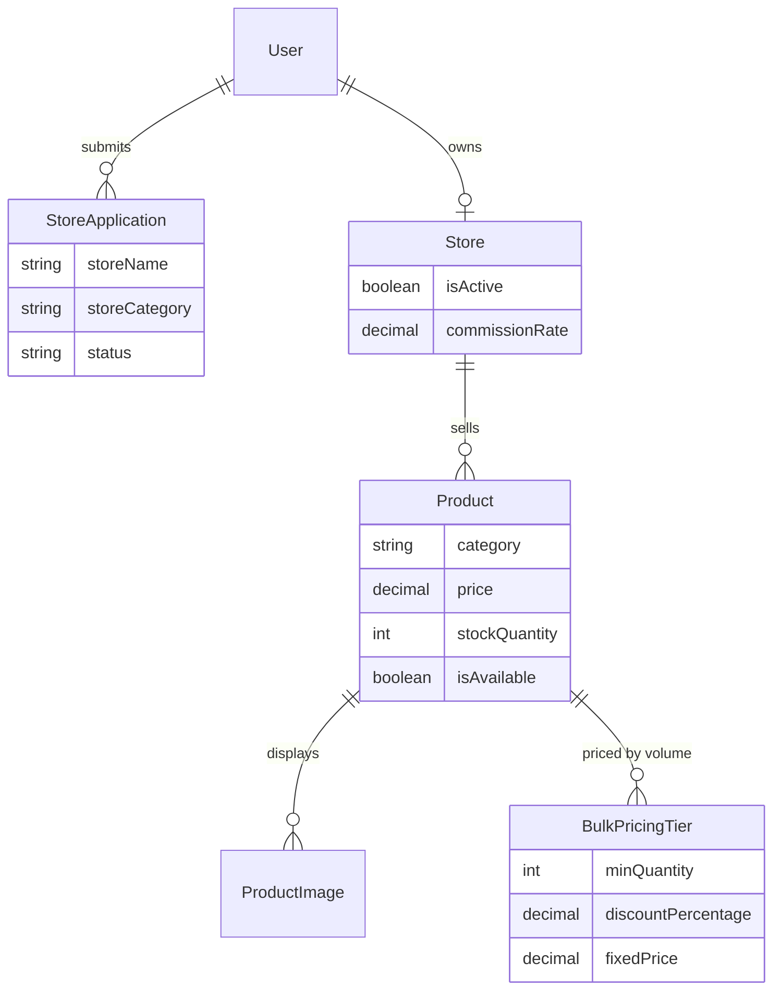
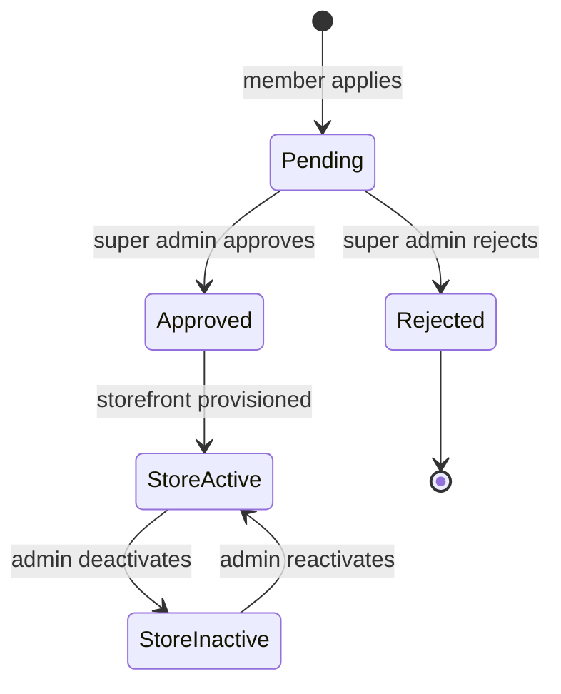

# Domain 09 — Marketplace

The Marketplace context brings football businesses into the same ecosystem as the clubs and players they serve. Kit suppliers, equipment shops, health and nutrition brands, and trophy and medal makers apply for a storefront. Once a platform administrator approves them, they run a catalogue that every member can browse. The context is built as a governed marketplace: sellers are vetted, storefronts can be suspended centrally, and catalogue data is structured for a later commerce layer.

## Responsibilities

- Accept storefront applications from authenticated members and run the approval workflow
- Provision one storefront per approved applicant, linked to their account
- Manage product catalogues: categories, pricing, stock, availability, tags and ordered image galleries
- Model volume pricing through bulk pricing tiers
- Provide public browsing of active stores and available products
- Give super admins oversight: review applications, activate or deactivate stores, view every store

## Ubiquitous language

| Term | Meaning |
|---|---|
| Store application | A member's request to open a storefront, with business details and category |
| Store | An approved storefront owned by exactly one user |
| Store category | The seller's segment: sports, health, accessories, books, other |
| Product | A catalogue item with price, stock quantity and an availability flag |
| Product category | Equipment, sportswear, supplements, medals, trophies, books, accessories, other |
| Bulk pricing tier | A volume rule: from a minimum quantity, a percentage discount or a fixed unit price |
| Commission rate | The platform's configurable share on a store's sales |
| Store owner | A capability derived from owning a store, not a platform role |

## Model

## Key workflows

**1. Applying for a storefront.** A member submits an application. A super admin reviews the pending queue and approves or rejects it. Approval provisions the store and attaches it to the applicant's account, and the client then shows a "My Store" area.

**2. Catalogue management.** The store owner creates products with images uploaded through the shared file service, orders the gallery, edits pricing and tags, and marks items available or unavailable.

**3. Stock adjustment.** Stock changes are sent as positive or negative deltas rather than absolute values, which makes intent explicit and protects against lost updates between concurrent edits.

**4. Browsing.** Members browse the directory of active stores and filter available products by category. Items flagged unavailable are excluded from the public catalogue.

**5. Governance.** A super admin can deactivate a store at any time, for example for a policy breach. It leaves the public store directory immediately, and no data is deleted.

## Business rules & invariants

- A user may own at most one store
- A user may have only one pending application, and cannot apply at all while they already own a store
- Owning a store does not change the user's platform role; the store-owner capability is derived from ownership
- Stock can never go below zero; a delta that would make it negative is rejected
- Only the owning user can create, edit or delete their products and images
- Deactivating a store removes it from the public directory but keeps all data for reinstatement
- Bulk tiers are defined per product and always resolved in ascending order of minimum quantity; gallery images keep an explicit display order

## Access control

| Capability | Roles |
|---|---|
| Browse active stores and available products | any user, including unauthenticated visitors for public listings |
| Apply for a storefront and track the application | any authenticated user |
| Manage own store profile and catalogue | store owner (capability) |
| Review and approve applications | super_admin |
| Activate or deactivate stores, view all stores | super_admin |

## Integration points

| Context | Interaction |
|---|---|
| Core | Applications and stores belong to users; product media goes through the shared file-upload service |
| Navigation shell | Store ownership is detected at sign-in to show seller or applicant menus |
| Finance (roadmap) | Commission and payment collection will reuse the provider abstraction described in Finance & Discipline |

## Engineering notes

- **Capability over role.** As with referee branch admins, store ownership is inferred from data rather than added as a new role, so a team manager can also run a shop without any role juggling.
- **Delta-based stock updates.** Expressing stock changes as signed deltas, with a non-negative invariant, avoids last-write-wins errors when several sessions edit the same product.
- **Commerce-ready catalogue.** Bulk tiers, commission rate and structured categories are modelled now, so a checkout engine can be added without migrating catalogue data.
- **Soft governance.** Store deactivation is a reversible flag, not a delete, which keeps moderation safe and auditable.

## Roadmap

- Cart, checkout and order management
- Payments and commission settlement through the shared payment-provider interface
- Seller analytics and product reviews

---

**Prev:** [Domain 08 — Operations](08-operations.md) | **Next:** [Domain 10 — Survey](10-survey.md) | **Up:** [Domain model](../04-domain-model.md)
