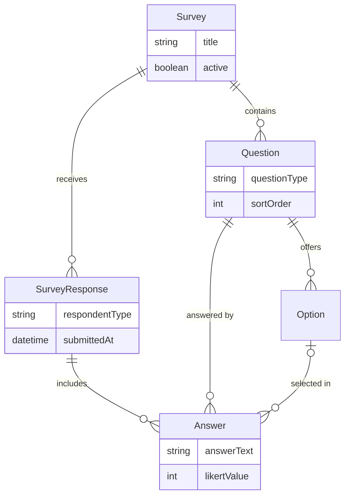
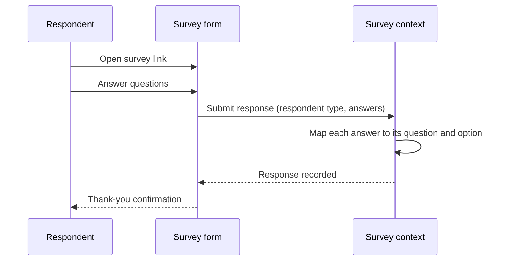

# Domain 10 — Survey

The Survey context is a self-contained feedback instrument. It collects structured responses from the people who use the platform day to day (team managers, referees and players) and turns them into aggregated reports that inform product and governance decisions. It is intentionally decoupled from the rest of the domain model: respondents do not need a platform account, and no other context depends on it. That makes it a low-risk channel for gathering candid feedback during rollouts.

## Responsibilities

- Define surveys as ordered sets of typed questions with selectable options
- Accept response submissions, optionally tagged with a respondent type and contact
- Aggregate answers per question type: Likert statistics, option frequencies, free-text collections
- Produce a per-survey report with client-side CSV export
- Stay isolated from identity and competition data so feedback can be gathered from anyone

## Ubiquitous language

| Term | Meaning |
|---|---|
| Survey | A questionnaire with a title, description and active flag |
| Question | One prompt with a type (Likert scale, single choice, multiple choice, dropdown, free text) and a sort order |
| Option | A selectable choice for single, multiple or dropdown questions |
| Survey response | One respondent's complete submission |
| Answer | The response to a single question: free text, a selected option or a Likert value |
| Respondent type | Self-declared cohort: team manager, referee or player |
| Report | The aggregated view of every response to one survey |

## Model

## Key workflows

**1. Responding.** A respondent opens a lightweight survey form, answers the questions and submits. The submission is stored as one response with one answer per question.

**2. Likert aggregation.** For each scale question the report computes the mean score and the distribution across scale points.

**3. Choice aggregation.** Single, multiple and dropdown questions are reduced to option frequency counts.

**4. Free-text collection.** Open answers are listed per question for qualitative review.

**5. Export.** The report view exports the aggregated data to CSV in the browser for offline analysis.

## Business rules & invariants

- Every answer belongs to exactly one response and references exactly one question
- A response always belongs to a single, existing survey
- Likert values are stored as integers so averages and distributions are computed exactly
- Respondent type is a self-declared cohort label used for segmentation, not an identity claim
- Contact details are optional and are not linked to platform accounts
- Questions are reported in their defined sort order, so reports mirror the questionnaire layout

## Access control

| Capability | Roles |
|---|---|
| Submit a response | anyone with the survey link (no account required) |
| View aggregated results and export CSV | platform operators and invited stakeholders |
| Create and configure surveys | platform operators (provisioned centrally) |

The platform roles (super_admin, league_admin, team_manager, referee, user) are deliberately not required, so the context can collect feedback before people are onboarded.

## Integration points

| Context | Interaction |
|---|---|
| Core | None by design; optional contact details are not linked to user accounts |
| All other contexts | None; the survey context neither reads nor writes competition data |

## Engineering notes

- **Deliberately standalone.** Keeping Survey outside the identity and competition graph means it can be deployed, changed or retired without touching any other context. It is a clear example of a generic subdomain in the domain-driven design sense.
- **Typed answers, not blobs.** Answers keep separate fields for text, selected option and Likert value, so aggregation is a straightforward grouped query instead of parsing stored JSON.
- **Schema-per-context.** Like every bounded context, Survey owns its own database schema, which keeps its tables out of the core model.

## Roadmap

- Survey authoring and results inside the web admin console
- Targeted surveys sent to role cohorts with optional sign-in attribution
- Season-over-season trend comparisons

---

**Prev:** [Domain 09 — Marketplace](09-marketplace.md) | **Next:** [Domain 11 — Finance & Discipline](11-finance-discipline.md) | **Up:** [Domain model](../04-domain-model.md)
