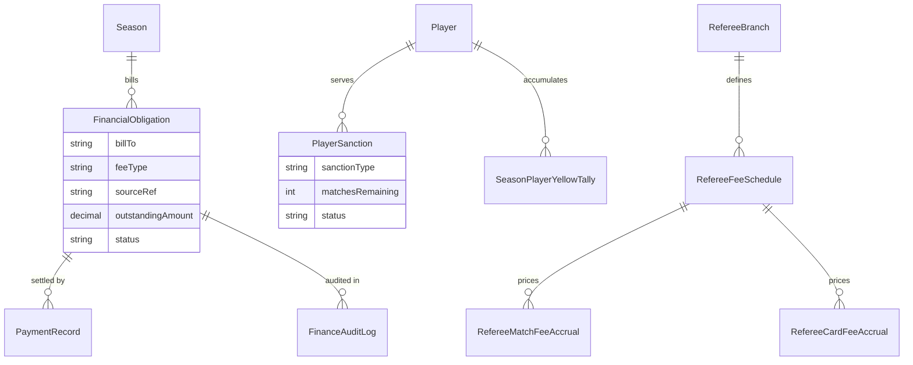
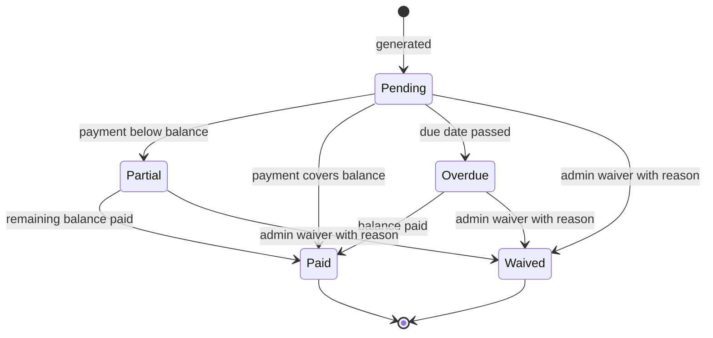
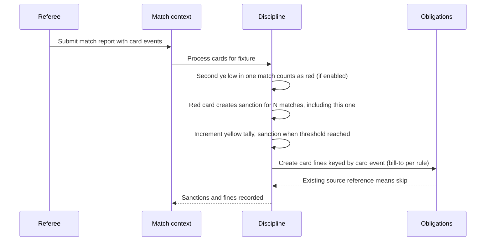

# Domain 11 — Finance & Discipline

The Finance & Discipline context holds the platform's **mutable money and sporting-ban state**. Responsibilities are split cleanly: [Policy](07-policy.md) declares *what* is charged and *how long* bans last, and this context records *who owes what* and *who is suspended for which fixtures*. Card events from submitted match reports automatically generate fines and suspensions. Unpaid participation fees block a season from starting, and suspended players are rejected from lineups. A separate ledger lets referee branches track the match fees and card fees accrued from officiating.

## Responsibilities

- Generate financial obligations from policy rules: participation fees, card fines, misconduct and custom charges
- Record manual payments and waivers against obligations, with a full audit trail
- Apply suspensions from red cards, double yellows and season-long yellow accumulation
- Enforce two hard gates: season start (participation fees settled) and lineup submission (no suspended players)
- Maintain referee branch fee schedules and accrue match fees and card fees
- Keep online payment collection behind a provider abstraction, ready for a later phase

## Ubiquitous language

| Term | Meaning |
|---|---|
| Fee type | Participation, yellow card, red card, misconduct or custom |
| Obligation | An amount owed for a season, with an outstanding balance and a status |
| Bill-to | Whether the debtor is the `TEAM` or the `PLAYER`, configurable per fee type |
| Source reference | Stable key identifying what caused an obligation or sanction, such as a specific card event |
| Payment | A recorded receipt against an obligation (cash, bank, mobile money, other) |
| Waiver | An admin's write-off of the remaining balance, with a mandatory reason |
| Sanction | A suspension covering an ordered set of the player's upcoming fixtures |
| Yellow tally | A season-scoped count of yellow cards per player |
| Fee schedule | A branch's match-fee rates per official role, plus card fee amounts |
| Accrual | A snapshot of a fee earned at the moment the triggering event happened |

## Model

## Key workflows

**1. Obligation lifecycle.** Obligations move through a small state machine. Payments reduce the outstanding balance, and waivers close it with a recorded reason.

**2. Discipline on report submit.** When a referee submits a match report, discipline is applied at the same moment as player statistics, so statistics, fines and bans all derive from the same submitted report.

**3. Participation fees and the season gate.** A league admin generates participation obligations for every team or player in a season, per the policy rule. Readiness reports a participation-fee check, and the season cannot move to in-progress until each such obligation is paid or waived.

**4. Lineup gate.** On lineup submission, any player whose active sanction covers the fixture is rejected, with the reason shown to the manager.

**5. Referee branch accruals.** Appointing an official records a match-fee accrual at the rate for that role (`MAIN`, `ASSISTANT1`, `ASSISTANT2`, `FOURTH`). Recording a yellow or red card on a fixture served by the branch records a card-fee accrual. Branch revenue is the sum of both; a referee's earnings come from match-fee accruals only.

## Business rules & invariants

- Obligations and sanctions are idempotent: each carries a source reference, so reprocessing a report never double-charges or double-suspends
- A suspension counts the match in which it was earned as the first of its N matches, and records the exact fixtures it covers
- A double yellow in one match is treated as a red card unless the league disables that rule; season accumulation applies on top
- Every admin override (waiving a fine, shortening, extending or waiving a suspension) requires a reason and writes an audit entry with before and after state
- Payments cannot exceed the outstanding balance, and closed obligations (paid or waived) accept no further payments; status follows from the balance and due date
- One currency per league, carried on the fee rule and every obligation
- Mid-season card fines are tracked on the ledger but do not stop a season that is already running
- Policy rules are never redefined here; this context only reads the effective rules for a season
- Branch card fees are branch revenue and are kept separate from team or player card fines

## Access control

| Capability | Roles |
|---|---|
| View season obligations and sanctions | super_admin, league_admin |
| Generate fees, record payments, waive, adjust sanctions | super_admin, league_admin with full financial access |
| View own team's obligations and player suspensions | team_manager |
| Create card fines and sanctions automatically | system, on match report submission |
| Edit branch fee schedules, view accruals and revenue | branch admin (own branch) |
| View own appointments that earn match fees | referee |

## Integration points

| Context | Interaction |
|---|---|
| Policy | Supplies fee and discipline rules; consumes participation-fee status as a readiness check |
| Match | Report submission triggers discipline; lineup submission checks sanctions |
| Competition | Season start transition enforces the participation-fee gate |
| Referee | Appointments and card events drive branch accruals |
| Team / Player | Debtors and sanctioned players |

## Engineering notes

- **Idempotency through source references.** Deriving a stable key from the triggering event makes fine and sanction generation safe to retry, so a repeated submission or reprocessing step can never double-bill a team or extend a ban.
- **Snapshot accruals.** Fees are copied at the moment of appointment or card, so changing a schedule never rewrites past revenue or earnings.
- **Fine-grained financial access.** League admins carry a financial access level, so viewing finances and moving money are separate permissions without adding a new role.
- **Payment provider seam.** Payment records already reserve provider and external-transaction fields. A planned `PaymentProvider` interface will support regional mobile-money and card providers through payment intents and idempotent webhooks, without changing policy rules or the shape of obligations.

---

**Prev:** [Domain 10 — Survey](10-survey.md) | **Next:** [Domain 00 — Core](00-core.md) | **Up:** [Domain model](../04-domain-model.md)
