# Media

Screenshots of Flame. None of the captures contain real customer data, people, organisations or infrastructure.

## Public pages

Captured with headless Edge driven by `puppeteer-core`, at 1440×900 for desktop and 390×844 @2x for mobile. The theme is set through the app's own persisted preference rather than CSS overrides, so what you see is exactly what the theme system renders.

| View | Light | Dark |
|---|---|---|
| Landing hero | 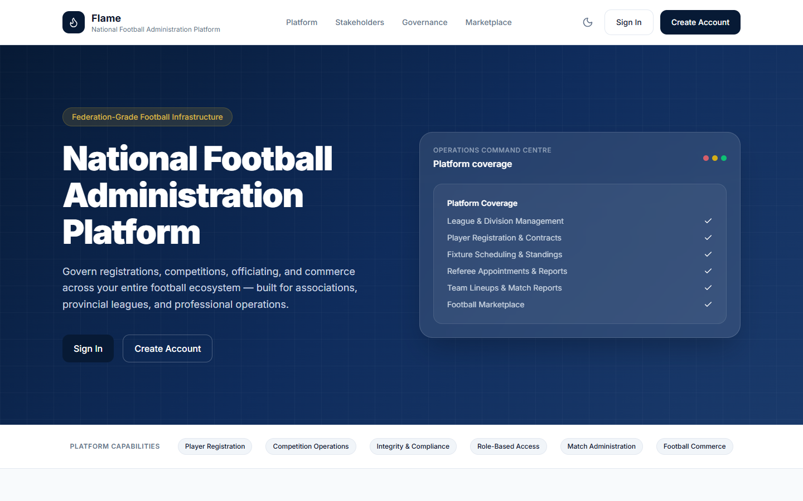 | 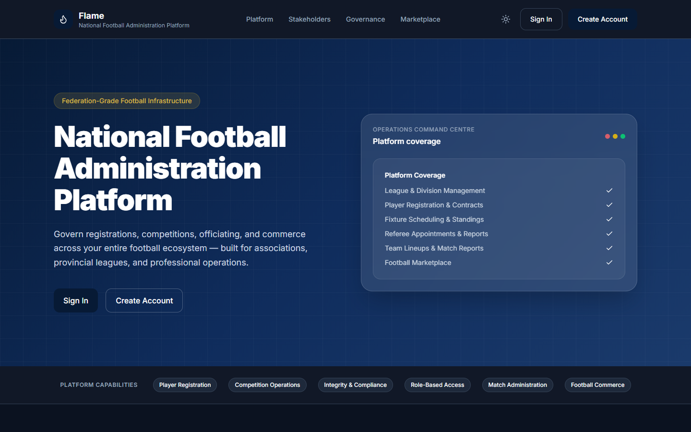 |
| Platform modules | 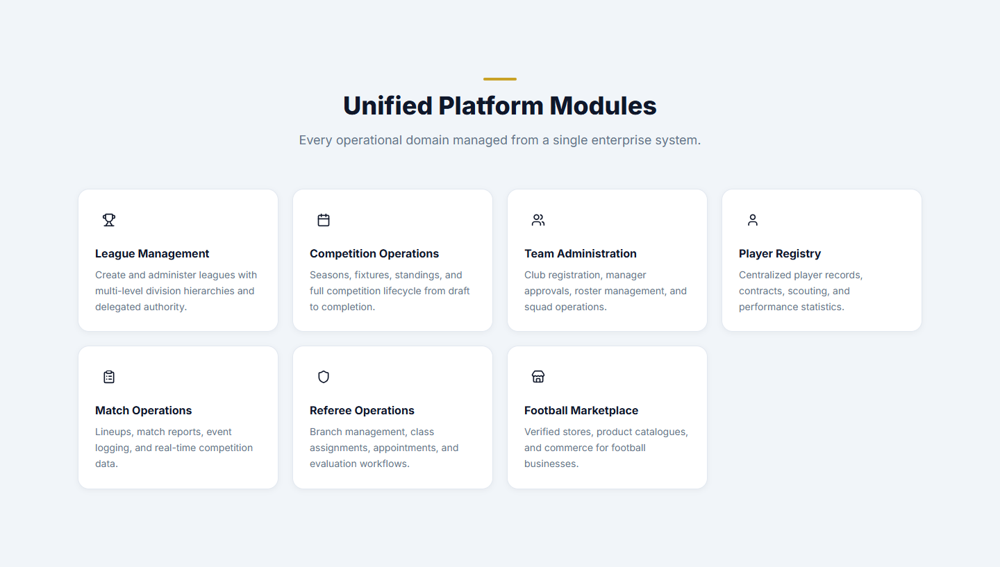 | 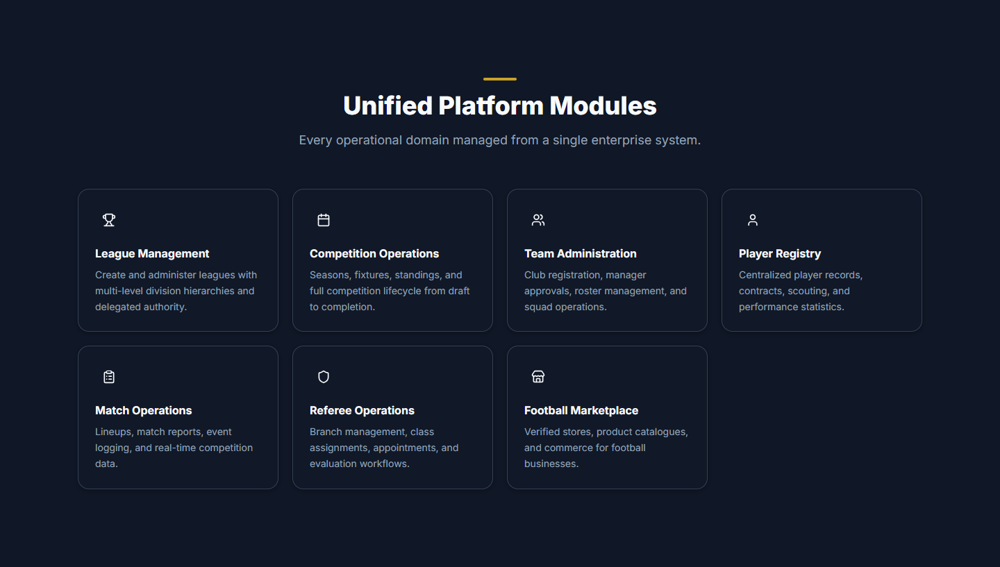 |
| Stakeholders | 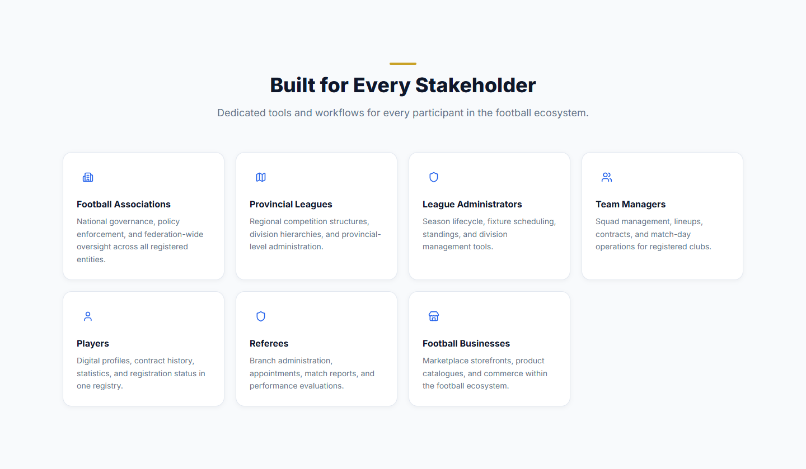 | 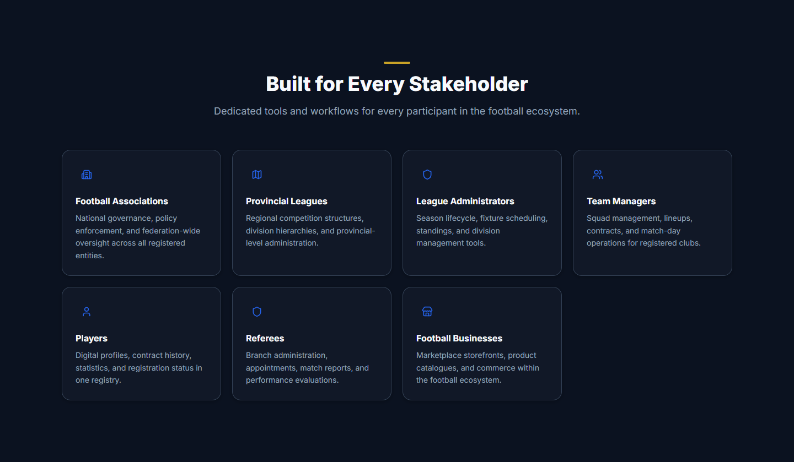 |
| Governance | 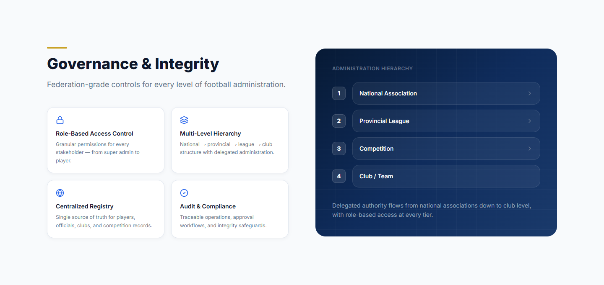 | 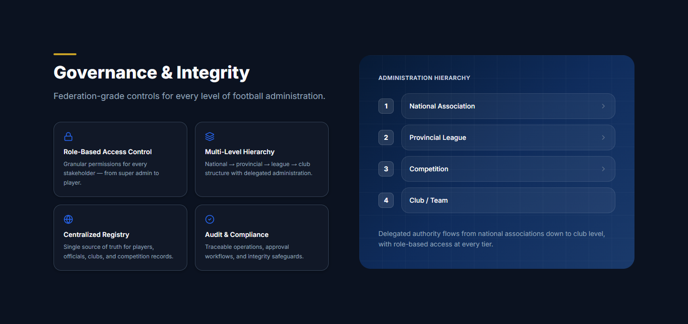 |
| Sign-in | 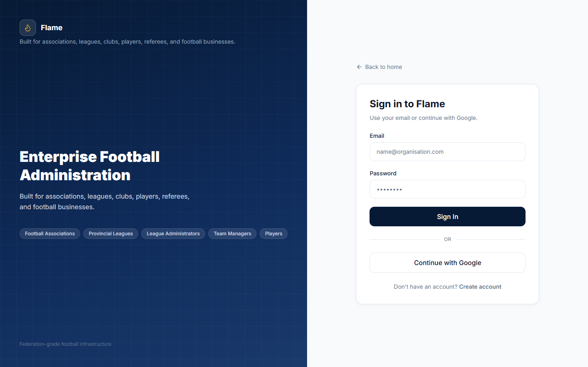 | 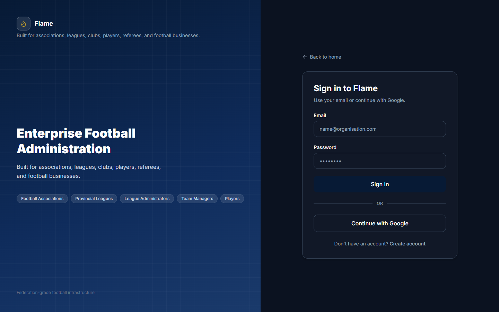 |
| Mobile web | 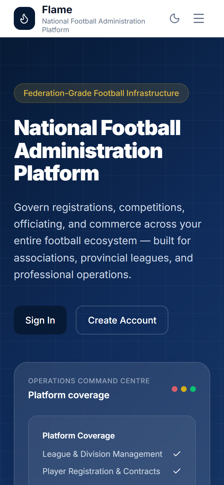 | 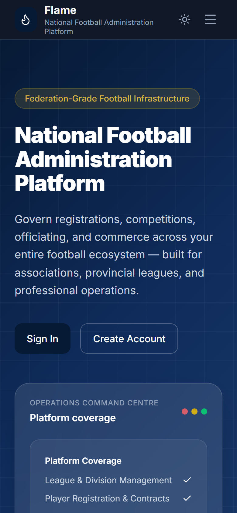 |

## Role dashboards (planned)

Authenticated views will only be captured from a **dedicated staging environment seeded with fictional data**, never from production or a copy of it.

| # | Role | View | Platform | What it demonstrates |
|---|---|---|---|---|
| 1 | Super admin | User governance console | Web | Search, role changes, suspension |
| 2 | League admin | Season readiness panel | Web | Policy readiness per team: blocking vs warning, waivers |
| 3 | League admin | Policy pack editor | Web | Draft, publish and versioning; division and season bindings |
| 4 | League admin | Fixture generator and schedule | Web | Round-robin output grouped by match week |
| 5 | League admin | Match-week readiness | Web | Referees, lineups and reports converging before kickoff |
| 6 | League admin | Finance ledger | Web | Obligations, payments, waivers with audit trail |
| 7 | Team manager | Pitch-board lineup editor | Web + mobile | Formation, lock countdown, suspended players rejected |
| 8 | Team manager | Compliance uploads | Mobile | Documents and photos feeding readiness |
| 9 | Referee | Live match report | Mobile | Event logging, cards, submission |
| 10 | Branch admin | Appointments and fee schedule | Web | Four official roles, accrued revenue |
| 11 | Member | Standings and scouting rankings | Mobile | Public competition data |
| 12 | Any | Demo GIF: lineup submit → lock → report → suspension | Web | End-to-end flow across five contexts |

### Fictional-data rules

- Organisations use invented names only (for example "Northern Provincial League", "Riverside FC", "National Referees Body").
- People get generated names that are checked against nothing real, and photos are illustrations or generated avatars.
- Emails use `example.com`; phone numbers use reserved fictional ranges.
- No browser chrome, address bar, devtools, notifications or OS taskbar in frame.
- No real hostnames, environment banners, build IDs or version strings that identify an environment.
- Every capture is reviewed by a second person before it is committed, and the repository's redaction check runs on every push.

### Capture guide

1. Seed the staging environment from the fictional fixture set; confirm there is no production data.
2. Desktop: 1440×900 at 1x. Mobile: 390×844 at 2x, or an iOS or Android simulator with the status bar cleaned.
3. Capture light and dark for every view, using the in-app theme toggle.
4. Save as PNG with `<area>-<view>-<theme>.png`; keep each file under about 500 KB.
5. Demo GIF: record at 1280×800, at most 20 seconds, 12–15 fps, optimised to under 8 MB.
